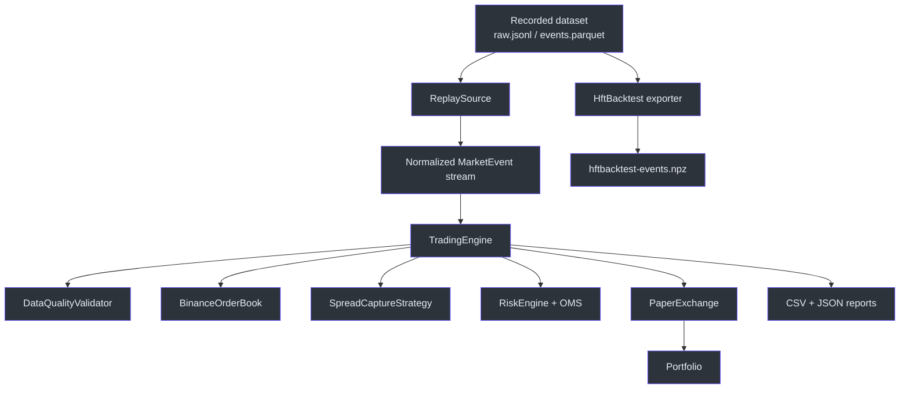
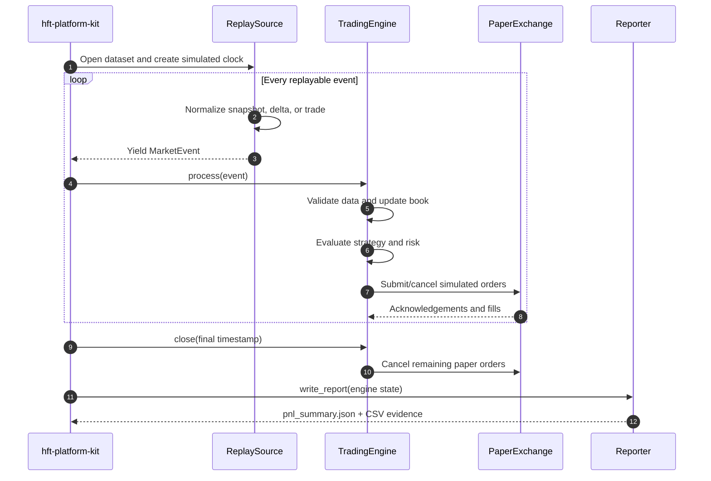
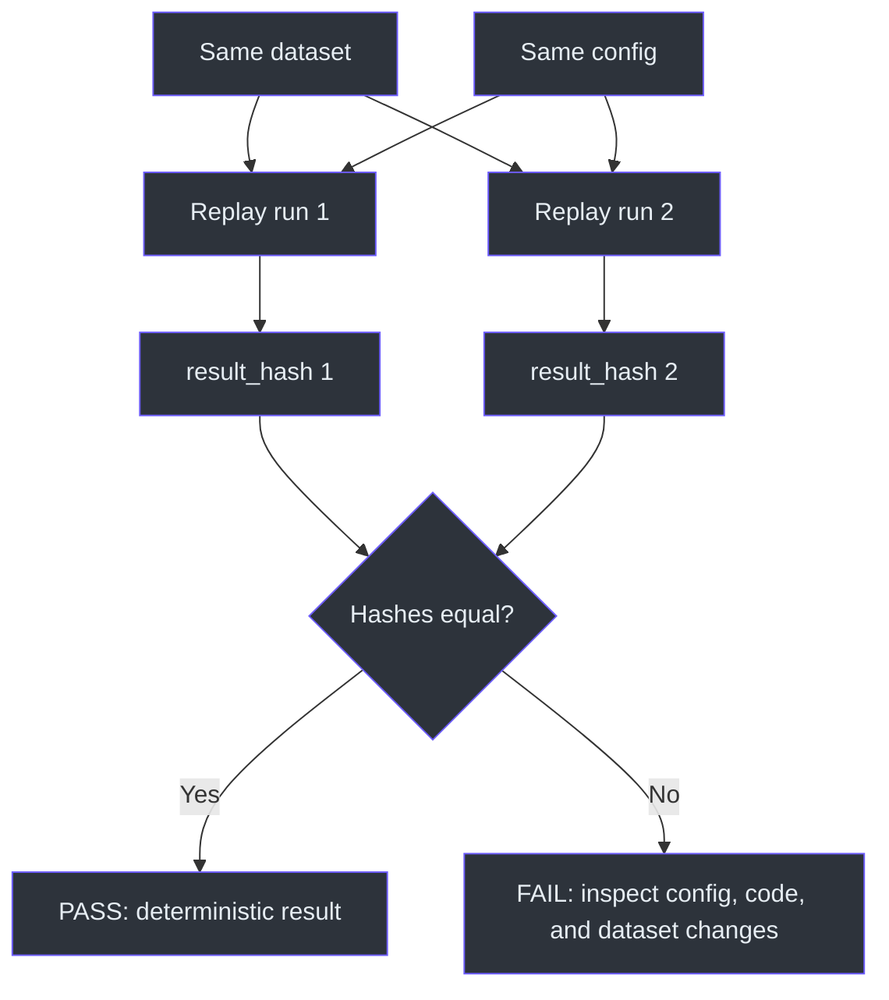
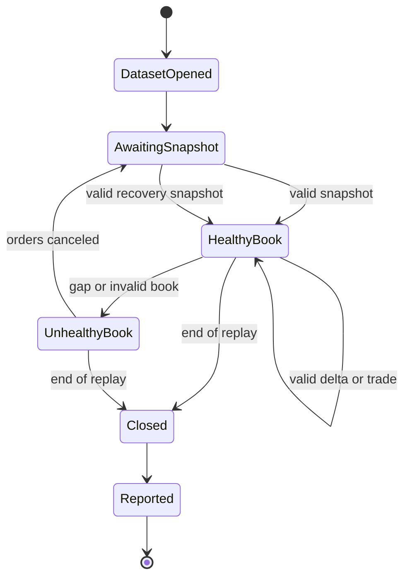

# Backtesting Demo Plan

This plan demonstrates the repository's two backtesting surfaces:

1. **Native deterministic replay** through the same order book, strategy, risk,
   OMS, paper exchange, portfolio, data-quality, and reporting components used
   elsewhere in the platform.
2. **HftBacktest export** to a compressed NumPy event array for downstream
   latency, queue-position, and fill-model experiments.

No exchange credentials are required. Replay reads local data and routes orders
to `PaperExchange`; it does not submit orders to Binance. The replay command
constructs `TradingEngine`, processes every replayed event, closes resting paper
orders, and writes a report directory
([applications.py:291-326](https://github.com/ankurarrah/hft-platform-kit/blob/main/src/trading_platform_poc/applications.py#L291-L326)).

## What You Will Prove

| # | Claim under test | Pass condition | Source |
|---|---|---|---|
| 1 | The environment has a working HftBacktest installation | `hft-health` reports a version, event dtype, and `BacktestAsset` | [hftbacktest_integration.py:67-76](https://github.com/ankurarrah/hft-platform-kit/blob/main/src/trading_platform_poc/hftbacktest_integration.py#L67-L76) |
| 2 | Recorded datasets can be discovered without guessing paths | `datasets` lists at least one dataset with its path and event count | [datasets.py:8-33](https://github.com/ankurarrah/hft-platform-kit/blob/main/src/trading_platform_poc/datasets.py#L8-L33) |
| 3 | Replay exercises the real platform pipeline | A report contains book, order, fill, PnL, data-quality, and latency results | [engine.py:31-67](https://github.com/ankurarrah/hft-platform-kit/blob/main/src/trading_platform_poc/engine.py#L31-L67) |
| 4 | Replay is deterministic | Two runs over the same dataset have identical `result_hash` values | [reporting.py:117-168](https://github.com/ankurarrah/hft-platform-kit/blob/main/src/trading_platform_poc/reporting.py#L117-L168) |
| 5 | Replay speed changes pacing, not source ordering | `max`, `10x`, and `real-time` complete successfully | [replay.py:56-75](https://github.com/ankurarrah/hft-platform-kit/blob/main/src/trading_platform_poc/replay.py#L56-L75) |
| 6 | Normalized data converts to HftBacktest's real event dtype | The NPZ contains `data` with HftBacktest fields and non-zero rows | [hftbacktest_integration.py:13-64](https://github.com/ankurarrah/hft-platform-kit/blob/main/src/trading_platform_poc/hftbacktest_integration.py#L13-L64) |
| 7 | The behavior is covered by focused automated tests | The replay, dataset, and HftBacktest tests pass | [test_replay_integration.py:108-299](https://github.com/ankurarrah/hft-platform-kit/blob/main/tests/test_replay_integration.py#L108-L299) |

## Architecture at a Glance

| Stage | Input | Responsibility | Output |
|---|---|---|---|
| Dataset discovery | `data/` | Find manifest-backed or replayable directories | Dataset path |
| Replay source | `raw.jsonl` or `events.parquet` | Normalize events and apply simulated timing | `MarketEvent` stream |
| Trading engine | `MarketEvent` stream | Validate data, maintain the book, evaluate strategy, simulate execution, update portfolio | Engine state |
| Reporting | Final engine state | Write CSV/JSON evidence and deterministic hashes | `reports/<run_id>/` |
| HftBacktest export | `events.parquet` or `events.jsonl` | Map depth/trade events to HftBacktest flags and dtype | Compressed NPZ |



<!-- Sources: src/trading_platform_poc/replay.py:25-75, src/trading_platform_poc/engine.py:31-67, src/trading_platform_poc/reporting.py:13-201, src/trading_platform_poc/hftbacktest_integration.py:13-64 -->

The engine rejects unusable market data before strategy execution. It requires
a valid snapshot, detects sequence gaps, blocks trades while the book is
unhealthy, and cancels paper orders when market data becomes invalid
([engine.py:76-213](https://github.com/ankurarrah/hft-platform-kit/blob/main/src/trading_platform_poc/engine.py#L76-L213)).

## Time and Safety

| Item | Guidance |
|---|---|
| Estimated time | 15-20 minutes with an existing dataset |
| Credentials | None |
| Exchange orders | None; execution is local and simulated |
| Recommended shell | Bash |
| Generated files | Dataset files, `reports/<run_id>/`, and optional NPZ export |
| Cleanup | Commands are provided in Step 10 |

## Step 0: Install and Verify the Project

```bash
git clone https://github.com/ankurarrah/hft-platform-kit.git
cd hft-platform-kit
uv sync --frozen
```

Confirm the CLI and optional native integrations:

```bash
uv run hft-platform-kit --help
uv run hft-platform-kit --config config.yaml libraries
uv run hft-platform-kit --config config.yaml hft-health
```

Expected HftBacktest health shape:

```json
{
  "asset_type": "BacktestAsset",
  "event_dtype": [
    "ev",
    "exch_ts",
    "local_ts",
    "px",
    "qty",
    "order_id",
    "ival",
    "fval"
  ],
  "version": "2.4.4"
}
```

The health command creates an empty array with HftBacktest's installed
`event_dtype` and passes it to `BacktestAsset`, so this checks more than a
module import
([hftbacktest_integration.py:67-76](https://github.com/ankurarrah/hft-platform-kit/blob/main/src/trading_platform_poc/hftbacktest_integration.py#L67-L76)).

**PASS:** `hft-health` exits successfully and reports `BacktestAsset`.

## Step 1: Select or Create a Dataset

### Option A: Use an existing recording

```bash
uv run hft-platform-kit --config config.yaml datasets
```

Select the dataset with the largest event count:

```bash
DATASET="$(
  uv run hft-platform-kit --config config.yaml datasets \
  | uv run python -c '
import json
import sys

datasets = json.load(sys.stdin)
if not datasets:
    raise SystemExit("No datasets found; use Option B or C.")
selected = max(datasets, key=lambda item: item.get("event_count") or 0)
print(selected["path"])
'
)"

echo "DATASET=$DATASET"
```

Dataset discovery accepts directories with a manifest, `raw.jsonl`, or
`events.parquet`, and ignores unrelated directories
([datasets.py:8-33](https://github.com/ankurarrah/hft-platform-kit/blob/main/src/trading_platform_poc/datasets.py#L8-L33)).

### Option B: Record a fresh public Binance sample

No credentials are required:

```bash
uv run hft-platform-kit --config config.yaml record \
  --duration-seconds 30

DATASET="$(ls -td data/*/ | head -n 1)"
echo "DATASET=$DATASET"
```

### Option C: Import historical Tardis data

The first day of each month is generally available without an API key:

```bash
uv run hft-platform-kit --config config.yaml tardis-import \
  --from-date 2024-03-01 \
  --to-date 2024-03-02 \
  --filter depth \
  --filter trade \
  --max-events 5000

DATASET="$(ls -td data/*/ | head -n 1)"
echo "DATASET=$DATASET"
```

Inspect the selected dataset:

```bash
find "$DATASET" -maxdepth 1 -type f -print | sort
jq . "$DATASET/dataset_manifest.json"
```

**PASS:** `DATASET` names a directory containing `raw.jsonl` or
`events.parquet`.

## Step 2: Understand the Replay Flow



<!-- Sources: src/trading_platform_poc/applications.py:291-326, src/trading_platform_poc/replay.py:25-75, src/trading_platform_poc/engine.py:76-290, src/trading_platform_poc/reporting.py:13-201 -->

When a dataset directory is supplied, replay prefers `raw.jsonl` and otherwise
uses `events.parquet`. Supplying `quarantine.jsonl` is explicitly rejected
([replay.py:77-111](https://github.com/ankurarrah/hft-platform-kit/blob/main/src/trading_platform_poc/replay.py#L77-L111)).

## Step 3: Run the First Backtest

```bash
uv run hft-platform-kit --config config.yaml replay \
  --data "$DATASET" \
  --speed max 2>&1 | tee /tmp/hft-replay-1.log
```

Extract the generated report directory:

```bash
REPORT_1="$(
  uv run python -c '
import json
import sys

for line in open("/tmp/hft-replay-1.log", encoding="utf-8"):
    try:
        record = json.loads(line)
    except json.JSONDecodeError:
        continue
    if record.get("event") == "replay_mode_completed":
        print(record["report_directory"])
'
)"

echo "REPORT_1=$REPORT_1"
test -d "$REPORT_1"
```

Expected files:

```bash
find "$REPORT_1" -maxdepth 1 -type f -printf '%f\n' | sort
```

```text
anomalies.jsonl
fills.csv
opportunities.csv
order_updates.csv
orders.csv
pnl_summary.json
run_manifest.json
```

The report writer derives orders, state transitions, fills, opportunities,
portfolio state, fill/reject rates, and latency metrics from the final engine
state
([reporting.py:13-146](https://github.com/ankurarrah/hft-platform-kit/blob/main/src/trading_platform_poc/reporting.py#L13-L146)).

**PASS:** replay completes, `REPORT_1` exists, and `pnl_summary.json` is valid
JSON.

## Step 4: Inspect Backtest Results

```bash
jq '{
  run_id,
  mode,
  event_count,
  order_count,
  fill_count,
  opportunity_count,
  open_order_count,
  result_hash,
  portfolio,
  execution_metrics,
  data_quality
}' "$REPORT_1/pnl_summary.json"
```

Review the audit trail:

```bash
column -s, -t < "$REPORT_1/orders.csv" | sed -n '1,12p'
column -s, -t < "$REPORT_1/fills.csv" | sed -n '1,12p'
column -s, -t < "$REPORT_1/opportunities.csv" | sed -n '1,12p'
jq -c . "$REPORT_1/anomalies.jsonl" | sed -n '1,12p'
```

| Field | Interpretation | Source |
|---|---|---|
| `event_count` | Events presented to `TradingEngine.process` | [engine.py:76-78](https://github.com/ankurarrah/hft-platform-kit/blob/main/src/trading_platform_poc/engine.py#L76-L78) |
| `order_count` | Orders created by the OMS during replay | [reporting.py:153-176](https://github.com/ankurarrah/hft-platform-kit/blob/main/src/trading_platform_poc/reporting.py#L153-L176) |
| `fill_count` | Paper fills applied to the portfolio | [reporting.py:48-61](https://github.com/ankurarrah/hft-platform-kit/blob/main/src/trading_platform_poc/reporting.py#L48-L61) |
| `portfolio.net_pnl` | Realized plus unrealized PnL after fees | [reporting.py:117-146](https://github.com/ankurarrah/hft-platform-kit/blob/main/src/trading_platform_poc/reporting.py#L117-L146) |
| `result_hash` | SHA-256 of deterministic result data, excluding random `run_id` | [reporting.py:117-151](https://github.com/ankurarrah/hft-platform-kit/blob/main/src/trading_platform_poc/reporting.py#L117-L151) |
| `data_quality` | Anomaly counts and blocking status observed during replay | [engine.py:76-213](https://github.com/ankurarrah/hft-platform-kit/blob/main/src/trading_platform_poc/engine.py#L76-L213) |

Do not treat positive PnL on a short sample as evidence of a profitable
strategy. This demo proves deterministic mechanics and evidence generation,
not statistical significance.

## Step 5: Prove Determinism

Run the same dataset again:

```bash
uv run hft-platform-kit --config config.yaml replay \
  --data "$DATASET" \
  --speed max 2>&1 | tee /tmp/hft-replay-2.log

REPORT_2="$(
  uv run python -c '
import json

for line in open("/tmp/hft-replay-2.log", encoding="utf-8"):
    try:
        record = json.loads(line)
    except json.JSONDecodeError:
        continue
    if record.get("event") == "replay_mode_completed":
        print(record["report_directory"])
'
)"
```

Compare the deterministic fields:

```bash
HASH_1="$(jq -r .result_hash "$REPORT_1/pnl_summary.json")"
HASH_2="$(jq -r .result_hash "$REPORT_2/pnl_summary.json")"
BOOK_1="$(jq -r .book_checksum "$REPORT_1/pnl_summary.json")"
BOOK_2="$(jq -r .book_checksum "$REPORT_2/pnl_summary.json")"

printf 'run 1: result=%s book=%s\n' "$HASH_1" "$BOOK_1"
printf 'run 2: result=%s book=%s\n' "$HASH_2" "$BOOK_2"

test "$HASH_1" = "$HASH_2"
test "$BOOK_1" = "$BOOK_2"
echo "PASS: replay is deterministic"
```

`run_id` should differ. The `result_hash` excludes it and hashes sorted book,
order, update, fill, opportunity, portfolio, data-quality, and execution
metric data
([reporting.py:117-151](https://github.com/ankurarrah/hft-platform-kit/blob/main/src/trading_platform_poc/reporting.py#L117-L151)).



<!-- Sources: src/trading_platform_poc/reporting.py:117-191, tests/test_replay_integration.py:108-117 -->

**PASS:** both comparisons exit successfully.

## Step 6: Demonstrate Replay Speed Modes

Run accelerated replay:

```bash
uv run hft-platform-kit --config config.yaml replay \
  --data "$DATASET" \
  --speed 10x
```

For a short dataset, demonstrate receive-time pacing:

```bash
uv run hft-platform-kit --config config.yaml replay \
  --data "$DATASET" \
  --speed real-time
```

| Value | Behavior |
|---|---|
| `max` | No sleeping between events |
| `real-time`, `normal`, `realtime`, `1x` | Preserve receive-time gaps |
| `10x` | Preserve gaps divided by 10 |
| Any positive number | Use that number as the pacing multiplier |

The parser rejects zero, negative, or invalid speed values
([replay.py:160-184](https://github.com/ankurarrah/hft-platform-kit/blob/main/src/trading_platform_poc/replay.py#L160-L184)).
Automated tests also prove real-time pacing preserves timestamps and max-speed
replay never sleeps
([test_replay_integration.py:255-299](https://github.com/ankurarrah/hft-platform-kit/blob/main/tests/test_replay_integration.py#L255-L299)).

**PASS:** all selected speed modes complete without changing event order.

## Step 7: Export to HftBacktest

```bash
HFT_OUTPUT="${DATASET%/}/hftbacktest-events.npz"

uv run hft-platform-kit --config config.yaml hft-export \
  --data "$DATASET" \
  --output "$HFT_OUTPUT"

ls -lh "$HFT_OUTPUT"
```

Inspect the archive:

```bash
uv run python - "$HFT_OUTPUT" <<'PY'
import sys
import numpy as np

path = sys.argv[1]
with np.load(path) as archive:
    data = archive["data"]
    print("rows:", len(data))
    print("dtype:", data.dtype)
    print("first rows:")
    print(data[:5])

assert len(data) > 0
assert data.dtype.names == (
    "ev",
    "exch_ts",
    "local_ts",
    "px",
    "qty",
    "order_id",
    "ival",
    "fval",
)
PY
```

The exporter maps snapshots and deltas to depth flags, trades to trade flags,
buyer-maker direction to side flags, and preserves exchange/local timestamps,
price, and quantity
([hftbacktest_integration.py:13-64](https://github.com/ankurarrah/hft-platform-kit/blob/main/src/trading_platform_poc/hftbacktest_integration.py#L13-L64)).
It accepts either normalized Parquet or JSONL
([hftbacktest_integration.py:79-99](https://github.com/ankurarrah/hft-platform-kit/blob/main/src/trading_platform_poc/hftbacktest_integration.py#L79-L99)).

**PASS:** the NPZ exists, contains a non-empty `data` array, and its dtype
matches HftBacktest.

## Step 8: Demonstrate Programmatic Replay

The public SDK returns the populated engine, which is useful when a notebook or
research harness needs direct access to the final book, portfolio, OMS, or
custom strategy
([sdk.py:29-49](https://github.com/ankurarrah/hft-platform-kit/blob/main/src/hft_platform_kit/sdk.py#L29-L49)).

```bash
uv run python - "$DATASET" <<'PY'
import asyncio
import json
import sys

from hft_platform_kit import replay_dataset


async def main() -> None:
    engine = await replay_dataset(sys.argv[1], speed="max")
    print(
        json.dumps(
            {
                "events": engine.event_count,
                "book_checksum": engine.book.checksum(),
                "orders": len(engine.oms.orders),
                "fills": len(engine.portfolio.fills),
                "portfolio": engine.portfolio.snapshot(
                    engine.book.mid_price
                ),
                "data_quality": engine.data_quality.summary(),
            },
            indent=2,
            default=str,
        )
    )


asyncio.run(main())
PY
```



<!-- Sources: src/trading_platform_poc/engine.py:76-224, src/trading_platform_poc/engine.py:279-290, src/hft_platform_kit/sdk.py:29-49 -->

**PASS:** the script prints a non-zero event count and a book checksum.

## Step 9: Run the Focused Automated Tests

```bash
uv run pytest -q \
  tests/test_replay_integration.py \
  tests/test_hftbacktest_integration.py \
  tests/test_datasets.py
```

These tests cover:

| Behavior | Evidence |
|---|---|
| Deterministic replay and PnL generation | [test_replay_integration.py:108-117](https://github.com/ankurarrah/hft-platform-kit/blob/main/tests/test_replay_integration.py#L108-L117) |
| Sequence-gap recovery blocks trades until a new snapshot | [test_replay_integration.py:120-252](https://github.com/ankurarrah/hft-platform-kit/blob/main/tests/test_replay_integration.py#L120-L252) |
| Real-time and max-speed pacing | [test_replay_integration.py:255-299](https://github.com/ankurarrah/hft-platform-kit/blob/main/tests/test_replay_integration.py#L255-L299) |
| Real HftBacktest dtype and flags | [test_hftbacktest_integration.py:15-49](https://github.com/ankurarrah/hft-platform-kit/blob/main/tests/test_hftbacktest_integration.py#L15-L49) |
| Dataset discovery filtering | [test_datasets.py:6-31](https://github.com/ankurarrah/hft-platform-kit/blob/main/tests/test_datasets.py#L6-L31) |

**PASS:** all focused tests pass.

## Step 10: Cleanup

Keep the reports if you want an audit artifact. To remove only files created by
this demonstration:

```bash
rm -f /tmp/hft-replay-1.log /tmp/hft-replay-2.log
rm -f "${DATASET%/}/hftbacktest-events.npz"
```

To remove the two replay report directories:

```bash
rm -rf -- "$REPORT_1" "$REPORT_2"
```

Do not delete `DATASET` unless it was recorded or imported solely for this
demo.

## Pass/Fail Checklist

| Step | What must be true | Pass? |
|---|---|---|
| 0 | `hft-health` reports `BacktestAsset` and an event dtype | ☐ |
| 1 | A valid dataset path is selected or created | ☐ |
| 3 | Replay writes a complete report directory | ☐ |
| 4 | Summary, orders, fills, opportunities, and anomalies are inspectable | ☐ |
| 5 | Both `result_hash` and `book_checksum` match across two runs | ☐ |
| 6 | Selected replay speed modes complete successfully | ☐ |
| 7 | NPZ contains a non-empty HftBacktest `data` array | ☐ |
| 8 | SDK replay returns a populated engine | ☐ |
| 9 | Focused tests pass | ☐ |

## Troubleshooting

| Symptom | Cause | Resolution | Source |
|---|---|---|---|
| `No datasets found` | `data/` has no replayable directory | Record public data or import Tardis history | [replay.py:94-109](https://github.com/ankurarrah/hft-platform-kit/blob/main/src/trading_platform_poc/replay.py#L94-L109) |
| Literal `DATASET_ID` fails | Placeholder was copied instead of a real path | Run `datasets` and set `DATASET` | [replay.py:99-109](https://github.com/ankurarrah/hft-platform-kit/blob/main/src/trading_platform_poc/replay.py#L99-L109) |
| `quarantine.jsonl` is rejected | Quarantined events are intentionally not replayable | Use the dataset directory, `raw.jsonl`, or `events.parquet` | [replay.py:85-89](https://github.com/ankurarrah/hft-platform-kit/blob/main/src/trading_platform_poc/replay.py#L85-L89) |
| `dataset did not contain a usable book snapshot` | The data cannot initialize a valid order book | Select a complete recording containing a snapshot | [applications.py:309-310](https://github.com/ankurarrah/hft-platform-kit/blob/main/src/trading_platform_poc/applications.py#L309-L310) |
| Hashes differ | Dataset, config, strategy, or code changed between runs | Compare `run_manifest.json`, Git revision, and dataset files | [reporting.py:169-201](https://github.com/ankurarrah/hft-platform-kit/blob/main/src/trading_platform_poc/reporting.py#L169-L201) |
| HftBacktest import fails | Optional compiled dependency is unavailable | Run `uv sync --frozen`, then retry `hft-health` | [hftbacktest_integration.py:67-76](https://github.com/ankurarrah/hft-platform-kit/blob/main/src/trading_platform_poc/hftbacktest_integration.py#L67-L76) |
| Empty NPZ | Normalized dataset has no supported depth/trade events | Inspect `events.jsonl` or `events.parquet` event types | [hftbacktest_integration.py:13-64](https://github.com/ankurarrah/hft-platform-kit/blob/main/src/trading_platform_poc/hftbacktest_integration.py#L13-L64) |

## Scope and Limitations

| This demo proves | This demo does not prove |
|---|---|
| Deterministic event replay | Future profitability |
| Reuse of the platform's strategy/risk/OMS/paper path | Production exchange latency |
| Evidence generation and reproducible hashes | Queue position realism without calibration |
| HftBacktest-compatible event export | That the exported data alone defines a complete HftBacktest strategy |
| Data-quality behavior during replay | Statistical significance from a short recording |

## References

| Artifact | Purpose |
|---|---|
| [`src/trading_platform_poc/replay.py`](https://github.com/ankurarrah/hft-platform-kit/blob/main/src/trading_platform_poc/replay.py) | Dataset resolution, normalization, simulated clock, and pacing |
| [`src/trading_platform_poc/engine.py`](https://github.com/ankurarrah/hft-platform-kit/blob/main/src/trading_platform_poc/engine.py) | Shared trading pipeline and market-data health behavior |
| [`src/trading_platform_poc/reporting.py`](https://github.com/ankurarrah/hft-platform-kit/blob/main/src/trading_platform_poc/reporting.py) | CSV/JSON evidence and deterministic hashes |
| [`src/trading_platform_poc/hftbacktest_integration.py`](https://github.com/ankurarrah/hft-platform-kit/blob/main/src/trading_platform_poc/hftbacktest_integration.py) | HftBacktest health probe and NPZ conversion |
| [`src/hft_platform_kit/sdk.py`](https://github.com/ankurarrah/hft-platform-kit/blob/main/src/hft_platform_kit/sdk.py) | Programmatic replay API |

## Related Pages

| Page | Relationship |
|---|---|
| [README](README.md#replay-a-recording) | Concise replay and HftBacktest command reference |
| [Client Demo Runbook](CLIENT_DEMO_RUNBOOK.md) | Broader end-to-end platform demonstration |
| [Demo Guide](DEMO_GUIDE.md) | Engineer-facing walkthrough of recording, replay, and export |
| [HFT Verification Matrix](HFT_VERIFICATION_MATRIX.md) | Evidence index for platform capabilities |
| [SDK API](SDK_API.md) | Public embedding and strategy-extension interfaces |
