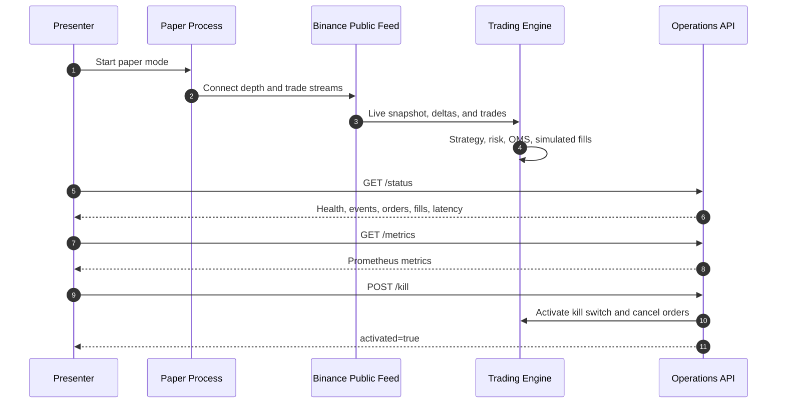
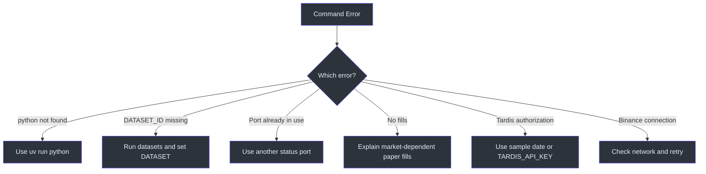

# HFT Trading Platform PoC Client Demonstration Runbook

## Purpose

This runbook provides a repeatable client demonstration of:

1. Automated quality checks.
2. Live Binance public market-data recording.
3. Raw, normalized, Parquet, and manifest artifacts.
4. Deterministic historical replay.
5. Tardis and HftBacktest integrations.
6. Live paper strategy, risk, OMS, and simulated execution.
7. Runtime status, Prometheus metrics, and manual kill switch.
8. Final opportunity, order, fill, exposure, latency, and PnL reports.

The demonstration sends **no real orders**. Live mode consumes public Binance
market data and routes all generated orders to the local `PaperExchange`.
(src/trading_platform_poc/binance_feed.py:119-201),
(src/trading_platform_poc/paper_exchange.py:26-267)

## Recommended Demo Agenda

| Section | Duration | Client takeaway |
|---|---:|---|
| Setup and tests | 2 minutes | The package is reproducible and tested |
| Library health | 1 minute | Required integrations are installed and active |
| Live recording | 2 minutes | The PoC captures real Binance data |
| Dataset inspection | 2 minutes | Data is auditable, analytical, and checksummed |
| Deterministic replay | 2 minutes | Identical input produces identical decisions |
| HftBacktest/Tardis | 2 minutes | Historical research integrations are active |
| Live paper mode | 3 minutes | Strategy, risk, OMS, monitoring, and kill switch work together |
| Two-venue execution | 3 minutes | Concurrent legs, partial fills, deterministic unwind, and reconciliation — offline |
| Reports | 1 minute | Results are traceable and client-reviewable |

```mermaid
flowchart LR
    SETUP[Setup] --> TESTS[75+ Automated Tests]
    TESTS --> LIBS[Integration Health]
    LIBS --> RECORD[Live Binance Recording]
    RECORD --> DATA[Inspect Dataset]
    DATA --> REPLAY[Deterministic Replay]
    REPLAY --> HFT[HftBacktest and Tardis]
    HFT --> PAPER[Live Paper Mode]
    PAPER --> CONTROL[Status, Metrics, Kill]
    CONTROL --> OPP[Two-Venue Concurrent Legs]
    OPP --> REPORT[Review Reports]

    style SETUP fill:#2d333b,stroke:#6d5dfc,color:#e6edf3
    style TESTS fill:#2d333b,stroke:#6d5dfc,color:#e6edf3
    style LIBS fill:#2d333b,stroke:#6d5dfc,color:#e6edf3
    style RECORD fill:#2d333b,stroke:#6d5dfc,color:#e6edf3
    style DATA fill:#2d333b,stroke:#6d5dfc,color:#e6edf3
    style REPLAY fill:#2d333b,stroke:#6d5dfc,color:#e6edf3
    style HFT fill:#2d333b,stroke:#6d5dfc,color:#e6edf3
    style PAPER fill:#2d333b,stroke:#6d5dfc,color:#e6edf3
    style CONTROL fill:#2d333b,stroke:#6d5dfc,color:#e6edf3
    style OPP fill:#2d333b,stroke:#6d5dfc,color:#e6edf3
    style REPORT fill:#2d333b,stroke:#6d5dfc,color:#e6edf3
```



<!-- Sources: src/trading_platform_poc/cli.py:20, src/trading_platform_poc/applications.py:31, src/trading_platform_poc/operations.py:98 -->

## Before the Client Call

Run these checks at least once before screen sharing:

```bash
cd /Users/ankusin/trading-platform-poc
uv sync
uv run pytest -q
```

Expected result:

```text
747 passed, 1 skipped without exchange demo credentials
```

This is the verified 2026-07-31 release baseline; the count may increase as
tests are added. The important result is that the complete suite passes without
failures. Coverage includes native EMS, Binance/OKX/Deribit adapters, book
sequencing, replay pacing, risk rejection, OMS transitions, partial fills,
recovery, Tardis, HftBacktest, operations endpoints, and the kill switch.
(tests/test_order_book.py:28-119), (tests/test_replay_integration.py:103-151),
(tests/test_operations.py:6-39)

## Step 1: Enter the Project and Install Dependencies

```bash
cd /Users/ankusin/trading-platform-poc
uv sync
```

**What it does**

- Creates or updates the isolated `.venv` environment.
- Installs versions locked in `uv.lock`.
- Installs Binance connectivity, Parquet, Tardis, HftBacktest, FastAPI,
  Prometheus, and the platform event loop (`uvloop`, or `winloop` on Windows).

**Presenter talking point**

> The project is reproducible from a locked dependency definition. The
> client does not need to install packages globally or manage Python manually.

## Step 2: Run the Automated Acceptance Suite

```bash
uv run pytest -q
```

**What it does**

- Executes unit and integration tests.
- Verifies deterministic replay.
- Verifies gap detection and snapshot recovery.
- Verifies risk, OMS, partial fills, fees, position, PnL, and kill behavior.
- Verifies real Tardis and HftBacktest package integration surfaces.

**Expected outcome**

```text
747 passed, 1 skipped without exchange demo credentials
```

## Step 3: Show Integrated Libraries

```bash
uv run trading-platform-poc --config config.yaml libraries
```

**What it generates**

A JSON list showing whether each integration is active and its role:

- Tardis
- HftBacktest
- PyArrow
- FastAPI
- Prometheus
- uvloop (winloop on Windows)
- Optional `level2-order-book` adapter
- Optional future OrderBook-rs/PyO3 adapter

Then verify HftBacktest:

```bash
uv run trading-platform-poc --config config.yaml hft-health
```

**Expected outcome**

A JSON response containing the installed HftBacktest version, event dtype, and
asset type. The command uses the actual installed package rather than a mock.
(src/trading_platform_poc/hftbacktest_integration.py:69-76)

## Step 4: Record Live Binance Market Data

```bash
uv run trading-platform-poc --config config.yaml record \
  --duration-seconds 30 \
  --max-events 500
```

**What it does**

1. Connects to Binance public `BTCUSDT` depth and trade streams.
2. Starts buffering incremental depth updates.
3. Fetches a REST order-book snapshot.
4. Synchronizes snapshot and deltas.
5. Detects gaps or invalid books and resynchronizes.
6. Writes native and normalized events.

**What it generates**

The final log prints a directory similar to:

```text
data/fbf3e858-7f6c-40e0-9786-c09e387056b6
```

The directory contains:

| File | Meaning |
|---|---|
| `raw.jsonl` | Original exchange-native messages |
| `events.jsonl` | Human-readable normalized events |
| `events.parquet` | Compressed analytical event table |
| `quarantine.jsonl` | Rejected events with structured anomaly reasons |
| `dataset_manifest.json` | Event counts, configuration fingerprint, sizes, and checksums |

The recorder writes all five artifacts from the same event stream.
(src/trading_platform_poc/recorder.py:16-178)

## Step 5: Select and Inspect the Dataset

List available datasets:

```bash
uv run trading-platform-poc --config config.yaml datasets
```

Select the most recent dataset:

```bash
DATASET="$(ls -td data/*/ | head -n 1)"
echo "$DATASET"
```

List generated files:

```bash
ls -lh "$DATASET"
```

Inspect the manifest:

```bash
uv run python -m json.tool "${DATASET%/}/dataset_manifest.json"
```

**What to highlight**

- `event_count`: total normalized events.
- `event_counts`: snapshots, deltas, and trades.
- `config_hash`: fingerprint of the effective configuration.
- `checksums`: SHA-256 fingerprints for each data file.
- `size_bytes`: physical file sizes.
- `quarantine_count`: number of events rejected by data-quality controls.
- `quarantine_counts`: rejected events grouped by anomaly code.

Inspect one native Binance message:

```bash
head -n 1 "${DATASET%/}/raw.jsonl" \
  | uv run python -m json.tool
```

Inspect one normalized event:

```bash
head -n 1 "${DATASET%/}/events.jsonl" \
  | uv run python -m json.tool
```

Inspect a quarantined event when present:

```bash
if test -s "${DATASET%/}/quarantine.jsonl"; then
  head -n 1 "${DATASET%/}/quarantine.jsonl" \
    | uv run python -m json.tool
else
  echo "No quarantined events"
fi
```

**Presenter talking point**

> Raw messages support exchange-level investigation. Normalized events are the
> stable application contract. Parquet supports efficient analytics. The
> manifest proves integrity and reproducibility.

## Step 6: Demonstrate Deterministic Replay

First replay:

```bash
uv run trading-platform-poc --config config.yaml replay \
  --data "$DATASET" \
  --speed max
```

Second replay:

```bash
uv run trading-platform-poc --config config.yaml replay \
  --data "$DATASET" \
  --speed max
```

**What it does**

- Replays the recorded native stream through the same normalizer.
- Uses `SimulatedClock` instead of wall-clock time.
- Runs the same book, strategy, risk, OMS, paper exchange, and reporting code.

**What to compare**

Both final log entries should show the same:

```text
book_checksum
result_hash
```

The randomly generated `run_id` will differ, which is expected.

Demonstrate accelerated replay:

```bash
uv run trading-platform-poc --config config.yaml replay \
  --data "${DATASET%/}/events.parquet" \
  --speed 10x
```

Demonstrate receive-time pacing:

```bash
uv run trading-platform-poc --config config.yaml replay \
  --data "$DATASET" \
  --speed real-time
```

Replay speed changes wall-clock duration but not the event ordering or strategy
result. (src/trading_platform_poc/replay.py:35-78)

## Step 7: Demonstrate HftBacktest Export

```bash
uv run trading-platform-poc --config config.yaml hft-export \
  --data "$DATASET" \
  --output "${DATASET%/}/hftbacktest-events.npz"

ls -lh "${DATASET%/}/hftbacktest-events.npz"
```

**What it does**

- Reads normalized JSONL or Parquet.
- Maps depth and trade events to HftBacktest event flags.
- Preserves exchange and local timestamps, side, price, and quantity.
- Produces a compressed NumPy/HftBacktest event array.

**What it generates**

```text
hftbacktest-events.npz
```

This is the handoff format for subsequent latency, queue, and fill-model
calibration. (src/trading_platform_poc/hftbacktest_integration.py:12-76)

## Step 8: Demonstrate Tardis Historical Import

Create a unique output directory:

```bash
TARDIS_OUT="data/tardis-$(date +%Y%m%d-%H%M%S)"
```

Import a small free sample:

```bash
uv run trading-platform-poc --config config.yaml tardis-import \
  --from-date 2024-03-01 \
  --to-date 2024-03-02 \
  --filter trade \
  --max-events 20 \
  --output "$TARDIS_OUT"
```

Inspect it:

```bash
ls -lh "$TARDIS_OUT"
uv run python -m json.tool \
  "${TARDIS_OUT%/}/dataset_manifest.json"
```

**What it does**

- Uses the real `tardis-dev` Python client.
- Fetches exchange-native Binance historical messages.
- Passes them through the same Binance normalizer.
- Produces the standard JSONL, Parquet, and manifest artifacts.

**Note**

Tardis may require `TARDIS_API_KEY` for dates outside its sample-data policy:

```bash
export TARDIS_API_KEY="CLIENT_KEY"
```

## Optional Step: Validate Binance Spot Testnet Execution

> For a full hands-on lifecycle — submit, modify, cancel, multi-leg
> dispatch, and a pass/fail checklist the client completes themselves —
> use [CLIENT_TESTNET_TEST_PLAN.md](CLIENT_TESTNET_TEST_PLAN.md). The steps
> below are the short connectivity check.

Create virtual Testnet credentials at <https://testnet.binance.vision/>:

```bash
export BINANCE_TESTNET_API_KEY="..."
export BINANCE_TESTNET_API_SECRET="..."
```

Check Testnet connectivity and symbol rules:

```bash
uv run hft-platform-kit \
  --config config.testnet.example.yaml \
  binance-testnet ping

uv run hft-platform-kit \
  --config config.testnet.example.yaml \
  binance-testnet rules --symbol BTCUSDT
```

Validate signing, risk, OMS, and Binance filters without creating an order:

```bash
uv run hft-platform-kit \
  --config config.testnet.example.yaml \
  binance-testnet submit \
  --symbol BTCUSDT \
  --side buy \
  --type market \
  --quantity 0.0001 \
  --daily-net-pnl 0 \
  --test-only
```

An actual virtual Testnet submission additionally requires:

```text
--confirm TESTNET
```

The integration supports market, limit/GTC, post-only `LIMIT_MAKER`, cancel,
query, account, open-order, recent-trade, and reconciliation operations.
Production Binance URLs are rejected by default.

## Step 9: Start Live Paper Trading

Open two terminals.

### Terminal 1

```bash
cd /Users/ankusin/trading-platform-poc

uv run trading-platform-poc --config config.yaml paper \
  --duration-seconds 60 \
  --status-port 8000
```

**What it does**

- Connects to live public Binance data.
- Synchronizes a current L2 order book.
- Evaluates the spread strategy.
- Applies pre-trade risk.
- Creates paper OMS orders.
- Simulates acknowledgements, cancellations, partial fills, fees, and PnL.
- Exposes status and metrics on localhost.

### Terminal 2

```bash
cd /Users/ankusin/trading-platform-poc
```

Check runtime state:

```bash
curl -s http://127.0.0.1:8000/status \
  | uv run python -m json.tool
```

**What it shows**

- Feed state.
- Processed event count.
- Order and fill count.
- Last event timestamp.
- Market-data delay.
- Processing lag.
- Data-quality anomaly and blocking-anomaly counts.

Check Prometheus metrics:

```bash
curl -s http://127.0.0.1:8000/metrics \
  | grep '^trading_poc_'
```

Activate the manual kill switch:

```bash
curl -s -X POST http://127.0.0.1:8000/kill \
  | uv run python -m json.tool
```

Verify stopped status:

```bash
curl -s http://127.0.0.1:8000/status \
  | uv run python -m json.tool
```

**Presenter talking point**

> The kill switch cancels resting paper orders and prevents new strategy
> orders. It does not rely on an automatic risk breach; an operator can invoke
> it directly.



<!-- Sources: src/trading_platform_poc/applications.py:212, src/trading_platform_poc/operations.py:98, src/trading_platform_poc/engine.py:80 -->

## Step 10: Demonstrate Two-Venue Concurrent-Leg Execution

This step needs **no network, no credentials, and no native extensions**. It
runs against in-process simulated venues, so it works on a locked-down laptop
and produces identical output every time.

```bash
uv run hft-platform-kit opportunity-demo --scenario filled
```

Both legs land, and three independently derived position views agree:

```json
{"state": "closed", "duplicate_free": true, "replay_is_idempotent": true,
 "reconciliation": {"balanced": true, "net_position": "0",
                    "risk_released": true, "realized_pnl": "19.996",
                    "exchange_positions": {"binance": "1", "okx": "-1"},
                    "local_positions":    {"binance": "1", "okx": "-1"},
                    "risk_positions":     {"binance": "1", "okx": "-1"}}}
```

**Say this.** The same signal is executed twice. The second call returns the
stored result without contacting either venue — that is what
`replay_is_idempotent` proves. Client order IDs are derived from the signal by
hash, so a retry, a reconnect, or a process restart all recompute the *same*
ID. Duplicating an order is arithmetically impossible, not merely unlikely.

Now break it on purpose:

```bash
uv run hft-platform-kit opportunity-demo --scenario partial
```

One leg fills 0.4 against the other's 1.0. The 0.6 residual breaches the 5%
policy, so the platform hedges it and closes flat:

```json
{"transitions": ["created", "risk_reserved", "orders_created", "dispatched",
                 "acknowledged", "timeout", "partially_filled",
                 "hedge_required", "unwinding", "reconciling", "closed"],
 "unwinds": [{"venue": "okx", "quantity": "0.6", "reason": "residual_exposure",
              "candidates": [{"venue": "okx", "cost": "100020.0010"},
                             {"venue": "binance", "cost": "100020.0010"}]}]}
```

**Say this.** Both venues priced identically, so the tie was broken by
configured priority. The losing candidate is persisted too, so an auditor can
reconstruct exactly why that venue was chosen.

And a rejection:

```bash
uv run hft-platform-kit opportunity-demo --scenario reject
```

A `MIN_NOTIONAL` filter failure is classified as an invalid order and attempted
**once** — retrying it would only burn rate limit — while the opposing leg's
exposure is unwound automatically.

Persist the ledger to show the audit trail:

```bash
uv run hft-platform-kit opportunity-demo --scenario filled --store ledger.db \
  2>/dev/null | uv run python -c "
import json, sys
from hft_platform_kit import OpportunityStore

opportunity_id = json.load(sys.stdin)['scenarios'][0]['opportunity_id']
print(opportunity_id)
with OpportunityStore('ledger-filled.db') as store:
    for event in store.load_events(opportunity_id):
        print(event.sequence, event.event_type)
"
```

```text
OPP-B05B22CA9D51AF5D
1 opportunity_created     9  state_transition
2 risk_reserved          10  leg_fill_progress
3 state_transition       11  leg_fill_progress
4 state_transition       12  state_transition
5 leg_submitting         13  state_transition
6 leg_acknowledged       14  risk_released
7 leg_submitting         15  state_transition
8 leg_acknowledged       16  reconciliation
```

**Say this.** The opportunity ID is a hash of the signal, so it is the same on
every machine and every run. `leg_submitting` is written before
`leg_acknowledged` — intent is durable *before* the venue is contacted. If the
process died between those two events, restart recovery would recompute the
same client order ID, ask the venue whether that order exists, and resume
without duplicating it.

<!-- Sources: src/trading_platform_poc/opportunity.py, src/trading_platform_poc/opportunity_store.py, src/trading_platform_poc/cli.py -->

## Step 11: Inspect the Final Reports

After Terminal 1 completes:

```bash
REPORT="$(ls -td reports/*/ | head -n 1)"
echo "$REPORT"
ls -lh "$REPORT"
```

Inspect the summary:

```bash
uv run python -m json.tool \
  "${REPORT%/}/pnl_summary.json"
```

Inspect strategy opportunities:

```bash
sed -n '1,5p' "${REPORT%/}/opportunities.csv"
```

Inspect order transitions:

```bash
sed -n '1,10p' "${REPORT%/}/order_updates.csv"
```

Inspect fills:

```bash
sed -n '1,10p' "${REPORT%/}/fills.csv"
```

**What the reports explain**

| Artifact | Client question answered |
|---|---|
| `opportunities.csv` | Why did the strategy decide to trade or not trade? |
| `orders.csv` | What was the final state of each order? |
| `order_updates.csv` | What happened to the order over time? |
| `fills.csv` | At what price, quantity, fee, and timestamp was it filled? |
| `pnl_summary.json` | What was the position, exposure, latency, fill rate, reject rate, and PnL? |
| `run_manifest.json` | Which configuration and result hash belong to this run? |
| `anomalies.jsonl` | Which market-data anomalies were detected and blocked? |

Reporting is generated from OMS state, fills, opportunities, portfolio state,
and book checksums. (src/trading_platform_poc/reporting.py:13-180)

## Common Demo Issues



<!-- Sources: src/trading_platform_poc/cli.py:20, src/trading_platform_poc/datasets.py:8, src/trading_platform_poc/binance_feed.py:154 -->

### `python: command not found`

Use:

```bash
uv run python -m json.tool FILE.json
```

Do not use an unqualified `python` command.

### `replay dataset does not exist: data/DATASET_ID`

`DATASET_ID` is documentation notation, not a literal directory.

```bash
uv run trading-platform-poc --config config.yaml datasets
DATASET="$(ls -td data/*/ | head -n 1)"
```

Then replay using `--data "$DATASET"`.

### Port 8000 is already in use

Use another port:

```bash
uv run trading-platform-poc --config config.yaml paper \
  --duration-seconds 60 \
  --status-port 8765
```

Then replace port `8000` with `8765` in the `curl` commands.

### No fills appear

This is not necessarily an error. Fills depend on live trade prices,
aggressor direction, quote prices, and the 60-second demonstration window.
The paper-exchange behavior is covered by deterministic automated tests even
when the live market does not touch a quote.

### Tardis import is rejected

Use the documented sample date or provide:

```bash
export TARDIS_API_KEY="CLIENT_KEY"
```

## Client Acceptance Checklist

| Check | Expected result |
|---|---|
| Dependencies | `uv sync` succeeds |
| Automated suite | All tests pass |
| Libraries | Required integrations show `active: true` |
| Recording | Five dataset artifacts are created |
| Integrity | Manifest includes event counts and checksums |
| Replay | Repeated runs produce matching hashes |
| HftBacktest | NPZ export is generated |
| Tardis | Historical sample dataset is generated |
| Paper mode | Live events, strategy, risk, and OMS operate |
| Status | `/status` returns current runtime state |
| Metrics | `/metrics` returns Prometheus values |
| Kill switch | `POST /kill` returns `activated: true` |
| Two-venue lifecycle | `opportunity-demo` closes flat with `balanced: true` |
| No duplicate orders | `duplicate_free` and `replay_is_idempotent` are both `true` |
| Deterministic unwind | The residual is hedged and every rejected venue candidate is recorded |
| Reporting | CSV and JSON report artifacts are produced |
| Safety | No real exchange order is submitted |

## Deployment Configuration That Is Not a Code Guarantee

Two properties of the execution-control plane are enforced only when the
plane is *configured* to enforce them. They are listed here because a
reviewer reading the code alone would be entitled to assume otherwise.

| Setting | Default | Why it matters | Production value |
|---|---|---|---|
| `require_reservation` | `False` | "Reserve every resource before the first leg is transmitted" is the guarantee that stops one leg executing while the next is refused for want of capacity. With the default, a caller may send with no reservation at all and the guarantee is a convention rather than a control. | `True` for every multi-leg strategy |
| `priority_ceilings` | `PRIORITY_CEILING_PCT` | Sets how much of each budget is held back for classes above the sender. The default holds 20% from quote refresh and 40% from research. | Tune per venue; keep the tightest ceiling above the largest atomic multi-message order, or that order can never be admitted |

Both are constructor arguments on `ExecutionControlPlane`, so the value in
force is visible in the deployment manifest and can be asserted on at
start-up.

```python
plane = ExecutionControlPlane(
    venue_budgets=..., global_budget=...,
    require_reservation=True,
)
assert plane.require_reservation, "multi-leg safety is off"
```

## Related Pages

| Page | Relationship |
|---|---|
| [Client PoC Overview](./CLIENT_POC_OVERVIEW.md) | Full scope, architecture, data formats, and acceptance criteria |
| [HFT Verification Matrix](./HFT_VERIFICATION_MATRIX.md) | Native EMS, adapter, packaging, and release evidence |
| [Multi-Exchange Adapters](./MULTI_EXCHANGE.md) | Guarded endpoints and official protocol references |
| [PoC Findings](./POC_FINDINGS.md) | Measurements, limitations, and production recommendations |
| [Two-Venue Execution](./TWO_VENUE_EXECUTION.md) | Concurrent-leg state machine, idempotency, timeouts, and unwind |
| [Project README](./README.md) | Concise developer quick start |
