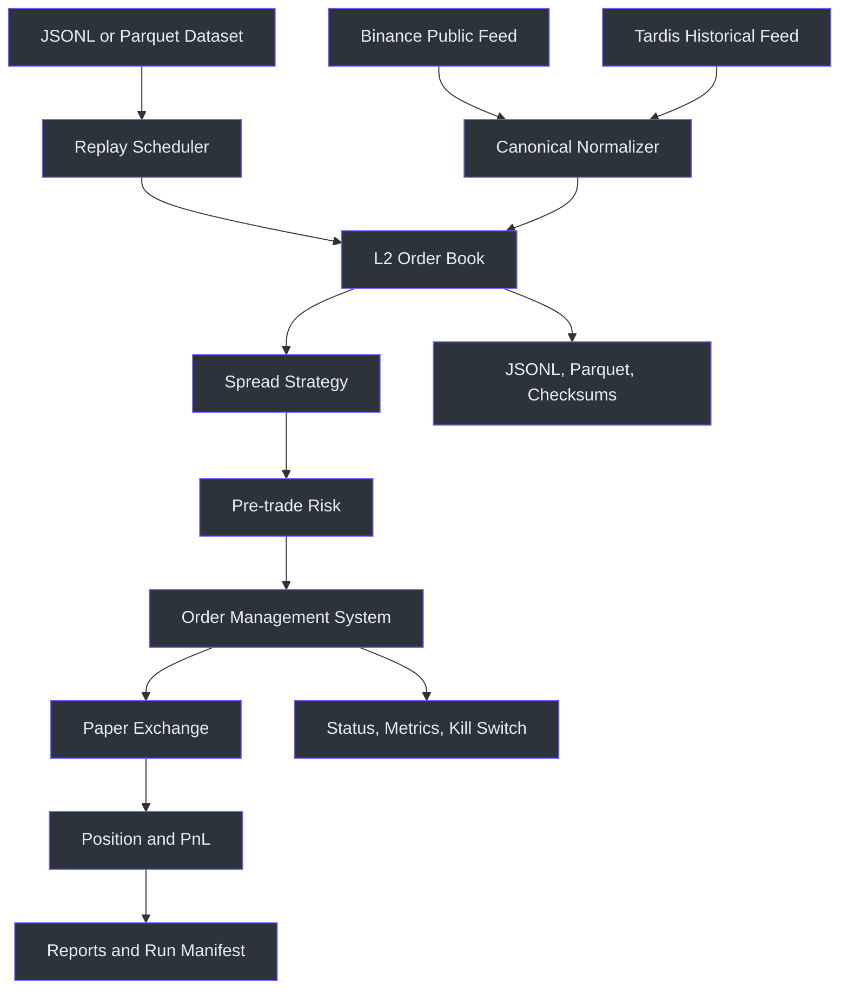
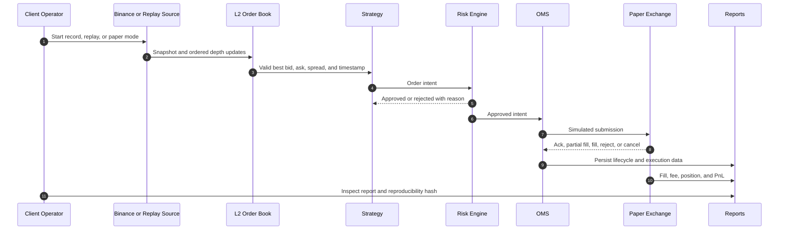
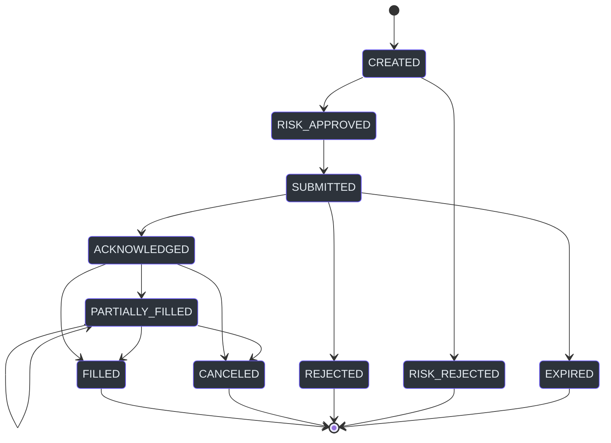
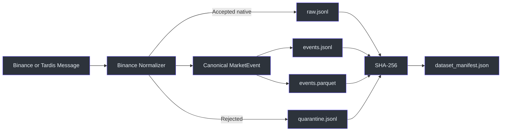
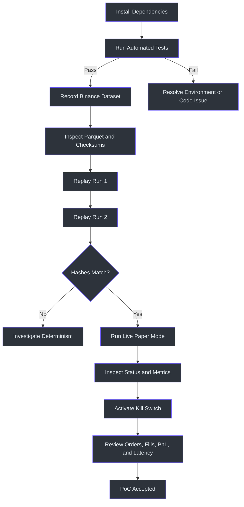

# HFT Trading Platform Proof of Concept

## Executive Overview

| Item | PoC position | Source |
|---|---|---|
| Purpose | Demonstrate a deterministic market-data, strategy, risk, OMS, paper-execution, and reporting pipeline | `TradingEngine` orchestration (src/trading_platform_poc/engine.py:26-178) |
| Market | Binance Spot market data, initially `BTCUSDT`; guarded execution adapters for Binance Testnet, OKX Demo, and Deribit Test | Exchange configuration (src/trading_platform_poc/config.py) |
| Execution | Local paper simulation plus credential-gated virtual Testnet/Demo execution; no live-money adapter is exposed | Paper exchange and EMS adapters (src/trading_platform_poc/paper_exchange.py), (src/trading_platform_poc/ems.py) |
| Operating modes | Live recording, historical replay, Tardis import, HftBacktest export, and live paper trading | Application entry points (src/trading_platform_poc/applications.py:31-340) |
| Safety | Pre-trade limits, stale-feed rejection, price collars, position limits, and a manual kill switch | Risk engine (src/trading_platform_poc/risk.py:19-82) |
| Evidence | Automated coverage for market data, replay determinism, risk, OMS, fills, recovery, integrations, and controls | Test suite (tests/test_order_book.py:28-119), (tests/test_replay_integration.py:103-151), (tests/test_kill_switch.py:16-59) |

The PoC exists to prove that the same strategy and control logic can process
both historical and live market data without introducing separate behavioral
paths. This reduces the risk that a strategy appears profitable in replay but
behaves differently when connected to a live feed.

It is a **controlled engineering demonstration**, not a production trading
system. Authenticated execution is restricted to Binance Spot Testnet, OKX
Demo, and Deribit Test and requires separate virtual credentials; live-money
endpoints remain disabled.

## Scope at a Glance

### Included

| Capability | What is covered | Source |
|---|---|---|
| Binance connectivity | Public depth and trade streams, heartbeat, reconnect, and REST depth snapshots | Binance feed (src/trading_platform_poc/binance_feed.py:119-201) |
| L2 order book | Snapshot loading, incremental updates, top-of-book, depth, spread, checksum, and gap detection | Order book (src/trading_platform_poc/order_book.py:21-169) |
| Data quality | Timestamp/skew, stale data, sequence, price, quantity, depth, spread, abnormal movement, and local checksum validation | Data-quality validator (src/trading_platform_poc/data_quality.py) |
| Historical replay | JSONL and Parquet replay at maximum, real-time, or accelerated speed | Replay source (src/trading_platform_poc/replay.py:24-159) |
| Historical provider | Tardis exchange-native Binance import through the common normalizer | Tardis source (src/trading_platform_poc/tardis_integration.py:17-79) |
| Strategy | Two-sided spread-capture quoting with configurable threshold and cooldown | Strategy (src/trading_platform_poc/strategy.py:11-91) |
| Pre-trade risk | Notional, net position, open orders, daily loss, stale feed, price collar, and kill switch | Risk engine (src/trading_platform_poc/risk.py:19-82) |
| OMS | Explicit order creation and validated lifecycle transitions | OMS (src/trading_platform_poc/oms.py:58-132) |
| Paper execution | Acknowledgements, latency, post-only rejection, partial fills, marketable fills, fees, and cancellation | Paper exchange (src/trading_platform_poc/paper_exchange.py:26-267) |
| Reporting | Opportunities, orders, transitions, fills, PnL, exposure, rates, latency, and reproducibility hashes | Reporting (src/trading_platform_poc/reporting.py:13-180) |
| Operations | `/status`, Prometheus `/metrics`, and `POST /kill` | Operations API (src/trading_platform_poc/operations.py:33-165) |
| HFT analysis | Export of normalized events into the installed HftBacktest event format | HftBacktest integration (src/trading_platform_poc/hftbacktest_integration.py:12-88) |
| Binance Testnet execution | Signed market, limit, post-only, cancel, query, account, open-order, recent-trade, and reconciliation operations | Binance gateway (src/trading_platform_poc/binance_execution.py) |
| Native EMS | C++ single-loop ordering, multi-leg risk reservation and recovery states, TWAP/VWAP, and fee/latency-aware SOR | Native core and coordinator (cpp/ems.cpp), (src/trading_platform_poc/ems.py) |
| Multi-exchange guarded execution | Binance Testnet, OKX Demo SPOT cash, and Deribit Test adapters behind one normalized contract | Adapter modules and tests (src/trading_platform_poc/ems.py), (tests/test_multi_exchange_adapters.py) |

### Explicitly Excluded

| Exclusion | Reason |
|---|---|
| Real-money order submission | The PoC exposes only paper, Testnet, Demo, and Test execution paths |
| Cross-venue atomic fills | The EMS coordinates and recovers multi-leg plans but cannot make independent venues transact atomically |
| Level-3 market-by-order reconstruction | L2 is sufficient for the PoC objective |
| Production queue-position calibration | HftBacktest export is present, but calibration requires additional live observations |
| High availability and disaster recovery | The PoC runs as a single process |
| Production-grade native engine | The C++ EMS is a validated PoC core, not a colocated production execution engine |
| Binance live-money execution | Testnet is integrated; production endpoints remain disabled |

## Architecture

| Layer | Responsibility | Source |
|---|---|---|
| Sources | Binance WebSocket/REST, recorded datasets, and Tardis | (src/trading_platform_poc/binance_feed.py:119-201), (src/trading_platform_poc/tardis_integration.py:17-68) |
| Canonical events | Typed snapshots, deltas, trades, orders, fills, and control events | Domain models (src/trading_platform_poc/models.py:1-166) |
| Market state | Deterministic L2 reconstruction and validation | (src/trading_platform_poc/order_book.py:21-169) |
| Decision path | Strategy followed by pre-trade risk | (src/trading_platform_poc/strategy.py:11-91), (src/trading_platform_poc/risk.py:19-82) |
| Execution path | OMS and simulated exchange | (src/trading_platform_poc/oms.py:58-132), (src/trading_platform_poc/paper_exchange.py:26-267) |
| Evidence | Parquet, manifests, CSV reports, PnL, status, and metrics | (src/trading_platform_poc/recorder.py:16-199), (src/trading_platform_poc/reporting.py:13-180) |



<!-- Sources: src/trading_platform_poc/applications.py:31, src/trading_platform_poc/engine.py:26, src/trading_platform_poc/reporting.py:13 -->

## End-to-End Data Flow

| Mode | Input | Processing | Output |
|---|---|---|---|
| Record | Live Binance depth and trades | Normalize, synchronize book, detect gaps, persist | Raw JSONL, normalized JSONL, Parquet, dataset manifest |
| Replay | Recorded JSONL or Parquet | Simulated clock, same book/strategy/risk/OMS | Deterministic execution and PnL report |
| Tardis import | Exchange-native historical Binance messages | Tardis client and common normalizer | Standard PoC dataset |
| Paper | Live Binance public market data | Same strategy/risk/OMS plus simulated exchange | Orders, fills, positions, metrics, PnL |



<!-- Sources: src/trading_platform_poc/engine.py:44, src/trading_platform_poc/risk.py:32, src/trading_platform_poc/paper_exchange.py:33, src/trading_platform_poc/reporting.py:13 -->

## Order Lifecycle

The OMS rejects illegal transitions rather than silently modifying an order.
The transition matrix is implemented centrally, and every accepted transition
produces an `OrderUpdate` record. (src/trading_platform_poc/oms.py:18-132)



<!-- Sources: src/trading_platform_poc/oms.py:18, src/trading_platform_poc/oms.py:96 -->

## Integrated Libraries

| Library | PoC use | Status | Source |
|---|---|---|---|
| `aiohttp` | Binance REST and WebSocket connectivity | Active | (src/trading_platform_poc/binance_feed.py:119-201) |
| `msgspec` | Typed events and deterministic serialization | Active | (src/trading_platform_poc/models.py:1-166) |
| `pyarrow` | Zstandard-compressed Parquet datasets | Active | (src/trading_platform_poc/recorder.py:16-178) |
| `tardis-dev` | Historical exchange-native Binance import | Active | (src/trading_platform_poc/tardis_integration.py:17-68) |
| `hftbacktest` | HFT-compatible historical-event export | Active | (src/trading_platform_poc/hftbacktest_integration.py:12-76) |
| FastAPI | Runtime status and kill-switch API | Active | (src/trading_platform_poc/operations.py:98-133) |
| Prometheus client | Runtime metrics | Active | (src/trading_platform_poc/operations.py:33-96) |
| `uvloop` / `winloop` | Low-overhead asyncio runtime (`winloop` on Windows) | Active | Loop selection (src/trading_platform_poc/runtime.py:1-38) |
| `level2-order-book` | Alternative L2 implementation | Evaluated optional adapter | Library assessment (src/trading_platform_poc/library_integrations.py:52-62) |
| OrderBook-rs | Potential future native engine through PyO3 | Evaluated future adapter | Library assessment (src/trading_platform_poc/library_integrations.py:63-75) |

## Client Setup Instructions

### Prerequisites

| Requirement | Expected value |
|---|---|
| Operating system | macOS or Linux |
| Python | 3.12 or newer |
| Package manager | `uv` |
| Network | Access to Binance public APIs |
| Credentials | None for record, replay, and paper modes |
| Optional credential | Tardis API key for non-free historical dates |

### Installation

```bash
cd /path/to/trading-platform-poc
uv sync
uv run pytest -q
```

The expected result is a successful automated test run. The suite covers book
synchronization, deterministic replay, reconnects, resynchronization, risk,
OMS transitions, paper fills, Tardis, HftBacktest, status APIs, and kill-switch
behavior. (tests/test_order_book.py:28-119), (tests/test_replay_integration.py:103-151),
(tests/test_recovery.py:26-67), (tests/test_operations.py:6-35)

## Demonstration Instructions

### 1. Verify Library Integrations

```bash
uv run trading-platform-poc --config config.yaml libraries
uv run trading-platform-poc --config config.yaml hft-health
```

### 2. Record Live Binance Market Data

```bash
uv run trading-platform-poc --config config.yaml record \
  --duration-seconds 30 \
  --max-events 500
```

The command prints a dataset directory such as:

```text
data/29872ab8-ba39-437a-b2c4-7b24318506a5
```

The dataset contains:

```text
raw.jsonl
events.jsonl
events.parquet
quarantine.jsonl
dataset_manifest.json
```

Each manifest contains event counts, schema information, configuration hash,
file sizes, and SHA-256 checksums. (src/trading_platform_poc/recorder.py:16-199)

## Understanding the Dataset Artifacts

The five files represent different views of the same recording. They are kept
together because no single format is ideal for exchange forensics, application
replay, analytical queries, and integrity verification.

| File | Data level | Primary purpose | Typical consumer | Source |
|---|---|---|---|---|
| `raw.jsonl` | Accepted exchange-native | Preserve original messages that passed blocking quality checks | Replay, feed debugging, re-normalization |
| `events.jsonl` | Canonical normalized | Provide readable, line-oriented PoC events | Developers, replay debugging, incident analysis |
| `events.parquet` | Canonical normalized and columnar | Efficient analytics, archival, and HftBacktest export | Python analytics, PyArrow, Polars, HftBacktest |
| `quarantine.jsonl` | Rejected canonical events | Preserve unsafe messages and structured anomaly reasons outside the strategy dataset | Operations, audit, troubleshooting |
| `dataset_manifest.json` | Dataset metadata | Identify, count, fingerprint, and validate the dataset | Operators, CI, reproducibility checks |



<!-- Sources: src/trading_platform_poc/recorder.py:16, src/trading_platform_poc/recorder.py:63, src/trading_platform_poc/recorder.py:130 -->

### `raw.jsonl`: Accepted Original Exchange Messages

**JSONL** means JSON Lines: every line is a complete JSON object. A recording
can therefore be streamed line by line without loading the full file into
memory. This file contains only messages accepted by blocking data-quality
checks; rejected messages are stored in `quarantine.jsonl`.

Example:

```json
{
  "receive_timestamp_ns": 1785427692180543000,
  "message": {
    "stream": "btcusdt@trade",
    "data": {
      "e": "trade",
      "s": "BTCUSDT",
      "t": 123456,
      "p": "64846.01",
      "q": "0.001",
      "T": 1785427692179,
      "m": true
    }
  }
}
```

| Field | Meaning |
|---|---|
| `receive_timestamp_ns` | Local timestamp when the PoC received the message, represented as nanoseconds since the Unix epoch |
| `message` | Original exchange-native message, retained without converting Binance field names |
| `message.stream` | Binance combined-stream identifier, such as depth or trade |
| `message.data` | Native Binance payload |

REST snapshots are also retained in this file. They use a small wrapper with
`source: "rest_snapshot"`, the symbol, and the original REST response. This
allows a replay to reconstruct the book from the same snapshot/delta boundary
used during recording.

**Why it exists**

- Provides the closest available representation of the external source.
- Allows normalization logic to be changed and rerun later.
- Supports investigation when a canonical event appears incorrect.
- Preserves Binance-specific fields that the PoC does not currently use.

**Important:** Native Binance field names are intentionally compact. For
example, `p` is trade price, `q` is quantity, `T` is trade time, and `m`
indicates whether the buyer was the maker. Client analysis should normally use
the normalized files unless exchange-level investigation is required.

Inspect the first message:

```bash
DATASET="$(ls -td data/*/ | head -n 1)"
head -n 1 "${DATASET%/}/raw.jsonl" | uv run python -m json.tool
```

The envelope is written directly by the recorder.
(src/trading_platform_poc/recorder.py:63-82)

### `events.jsonl`: Canonical PoC Events

This file contains the normalized representation used by the trading engine.
Each line is one typed `MarketEvent`, independent of Binance's compact field
names. (src/trading_platform_poc/models.py:138-151)

Simplified example:

```json
{
  "event_id": "0a9e7d7b-...",
  "run_id": "29872ab8-...",
  "venue": "binance",
  "symbol": "BTCUSDT",
  "event_type": "trade",
  "exchange_sequence": 123456,
  "exchange_timestamp_ns": 1785427692179000000,
  "receive_timestamp_ns": 1785427692180543000,
  "process_timestamp_ns": 1785427692180634000,
  "schema_version": 1,
  "payload": {
    "symbol": "BTCUSDT",
    "trade_id": 123456,
    "price": "64846.01",
    "quantity": "0.001",
    "buyer_is_maker": true,
    "trade_timestamp_ns": 1785427692179000000
  }
}
```

| Field | Meaning |
|---|---|
| `event_id` | Deterministic identifier for the normalized market event |
| `run_id` | Identifier of the recording or import run that produced the event |
| `venue` | Source venue, currently `binance` |
| `symbol` | Normalized instrument identifier |
| `event_type` | `book_snapshot`, `book_delta`, or `trade` for recorded market data |
| `exchange_sequence` | Exchange update ID or trade ID used for ordering and gap detection |
| `exchange_timestamp_ns` | Time assigned by the exchange, converted to nanoseconds |
| `receive_timestamp_ns` | Time the PoC received the message |
| `process_timestamp_ns` | Time normalization completed |
| `schema_version` | Version of the canonical event contract |
| `payload` | Typed event-specific data |

The three timestamps support different measurements:

```text
Market-data delay = receive_timestamp_ns - exchange_timestamp_ns
Processing lag    = process_timestamp_ns - receive_timestamp_ns
```

The payload shape depends on `event_type`:

| Event type | Payload content |
|---|---|
| `book_snapshot` | Snapshot update ID plus complete bid and ask price levels |
| `book_delta` | First/final update IDs plus changed bid and ask levels |
| `trade` | Trade ID, price, quantity, aggressor/maker indicator, and trade time |

**Why it exists**

- Human-readable normalized audit trail.
- Easy line-by-line debugging with standard command-line tools.
- Stable application contract shared by replay and live-paper processing.
- Source for comparing native and normalized representations.

Inspect the first normalized event:

```bash
head -n 1 "${DATASET%/}/events.jsonl" | uv run python -m json.tool
```

The same `MarketEvent` is serialized to JSONL and Parquet during one recorder
write operation. (src/trading_platform_poc/recorder.py:63-111)

### `events.parquet`: Analytical Columnar Dataset

Parquet contains the same normalized events as `events.jsonl`, but stores them
in a typed, column-oriented format compressed with Zstandard. This usually
provides smaller files and faster analytical scans because tools can read only
the required columns. (src/trading_platform_poc/recorder.py:16-31),
(src/trading_platform_poc/recorder.py:51-55)

| Parquet column | Type | Description |
|---|---|---|
| `event_id` | string | Canonical event identifier |
| `run_id` | string | Recording/import run identifier |
| `venue` | string | Exchange name |
| `symbol` | string | Instrument |
| `event_type` | string | Snapshot, delta, or trade |
| `exchange_sequence` | 64-bit integer | Update/trade sequence |
| `exchange_timestamp_ns` | 64-bit integer | Exchange timestamp |
| `receive_timestamp_ns` | 64-bit integer | Local receive timestamp |
| `process_timestamp_ns` | 64-bit integer | Normalization completion timestamp |
| `schema_version` | 32-bit integer | Canonical schema version |
| `payload_json` | string | Event-specific payload encoded as JSON |

**Why it exists**

- Efficient time-series and latency analysis.
- Direct input for PyArrow, Pandas, Polars, DuckDB, or similar tools.
- Compact archival form for larger recordings.
- Input for the PoC's HftBacktest exporter.
- Directly accepted by the replay command.

Inspect the schema and row count:

```bash
uv run python - "${DATASET%/}/events.parquet" <<'PY'
import sys
import pyarrow.parquet as pq

table = pq.read_table(sys.argv[1])
print(table.schema)
print("rows:", table.num_rows)
print(table.select(["event_type", "symbol"]).slice(0, 5))
PY
```

Replay Parquet directly:

```bash
uv run trading-platform-poc --config config.yaml replay \
  --data "${DATASET%/}/events.parquet" \
  --speed max
```

### `quarantine.jsonl`: Rejected Events and Anomaly Reasons

This file contains messages rejected by blocking data-quality controls. Each
line records the canonical event plus one or more structured anomalies,
including code, severity, message, symbol, timestamp, details, and whether the
condition was blocking.

Examples include:

- Future, stale, regressing, or incorrectly ordered timestamps.
- Duplicate or out-of-order trades and book updates.
- Invalid price or quantity bounds.
- Insufficient book depth or excessive spread.
- Structural book failures and sequence gaps.

The original native message is stored inside the quarantine record alongside
the canonical event and anomaly reasons. Quarantined events are not added to
`raw.jsonl`, `events.jsonl`, or `events.parquet`. This preserves forensic
evidence without contaminating replay, strategy, or analytical inputs.

```bash
head -n 1 "${DATASET%/}/quarantine.jsonl" \
  | uv run python -m json.tool
```

An empty file means no recording events were rejected.

### `dataset_manifest.json`: Dataset Identity and Integrity

The manifest describes the dataset rather than containing market events. It is
written after the recording closes, when final event counts, file sizes, and
checksums are known. (src/trading_platform_poc/recorder.py:130-178)

Example:

```json
{
  "dataset_id": "29872ab8-ba39-437a-b2c4-7b24318506a5",
  "symbol": "BTCUSDT",
  "schema_version": 1,
  "config_hash": "b33f82903fd3...",
  "event_count": 60,
  "event_counts": {
    "book_snapshot": 1,
    "book_delta": 46,
    "trade": 13
  },
  "quarantine_count": 0,
  "quarantine_counts": {},
  "checksums": {
    "raw.jsonl": "e72cd2d9287...",
    "events.jsonl": "ffd92e9dd06...",
    "events.parquet": "6f56c687b90..."
  },
  "files": {
    "raw.jsonl": {
      "sha256": "e72cd2d9287...",
      "size_bytes": 88885
    }
  }
}
```

| Field | Meaning |
|---|---|
| `dataset_id` | Unique directory/run identifier |
| `symbol` | Instrument or instruments represented |
| `schema_version` | Canonical event schema version |
| `config_hash` | SHA-256 fingerprint of the effective recording/import configuration |
| `event_count` | Total normalized event count |
| `event_counts` | Count grouped by event type |
| `quarantine_count` | Number of rejected events |
| `quarantine_counts` | Rejected events grouped by anomaly code |
| `checksums` | Convenient filename-to-SHA-256 map |
| `files` | Per-file checksum and byte size |

**Why it exists**

- Confirms whether a file changed after recording.
- Associates a dataset with the configuration that produced it.
- Allows automated checks before replay or client handoff.
- Provides a quick inventory without reading large event files.
- Supports reproducible comparison between environments.

Inspect the manifest:

```bash
uv run python -m json.tool "${DATASET%/}/dataset_manifest.json"
```

Verify a checksum on macOS:

```bash
cd "$DATASET"
shasum -a 256 raw.jsonl events.jsonl events.parquet
```

The calculated values should match `checksums` in the manifest. A mismatch
means the dataset is no longer byte-identical to the recorded artifact.

### Which File Should the Client Use?

| Client task | Recommended file |
|---|---|
| Replay accepted exchange-native messages | `raw.jsonl` |
| Inspect one normalized event manually | `events.jsonl` |
| Run analytics or HftBacktest conversion | `events.parquet` |
| Investigate rejected or unsafe messages | `quarantine.jsonl` |
| Verify completeness and integrity | `dataset_manifest.json` |
| Investigate normalization differences | Compare `raw.jsonl` with `events.jsonl` |
| Archive or transfer the dataset | Transfer all five files together |

### 3. Replay the Recording

Maximum-speed replay:

```bash
uv run trading-platform-poc --config config.yaml datasets
DATASET="$(ls -td data/*/ | head -n 1)"
uv run trading-platform-poc --config config.yaml replay \
  --data "$DATASET" \
  --speed max
```

Accelerated replay:

```bash
uv run trading-platform-poc --config config.yaml replay \
  --data "${DATASET%/}/events.parquet" \
  --speed 10x
```

Real-time replay:

```bash
uv run trading-platform-poc --config config.yaml replay \
  --data "$DATASET" \
  --speed real-time
```

Repeated runs over the same dataset and configuration should produce the same
`book_checksum` and `result_hash`. The pacing modes change wall-clock duration,
not strategy decisions. (src/trading_platform_poc/replay.py:35-78),
(tests/test_replay_integration.py:103-151)

### 4. Import Historical Data from Tardis

The first day of each month is available without an API key under the Tardis
sample-data policy.

```bash
uv run trading-platform-poc --config config.yaml tardis-import \
  --from-date 2024-03-01 \
  --to-date 2024-03-02 \
  --filter trade \
  --filter depth \
  --max-events 1000
```

For other dates:

```bash
export TARDIS_API_KEY="CLIENT_KEY"
```

The imported events use the same Binance normalizer and dataset writer as live
recordings. (src/trading_platform_poc/tardis_integration.py:17-68),
(src/trading_platform_poc/applications.py:162-210)

### 5. Export Data for HftBacktest

```bash
uv run trading-platform-poc --config config.yaml hft-export \
  --data "$DATASET" \
  --output "${DATASET%/}/hftbacktest-events.npz"
```

The exporter maps snapshots, deltas, trades, sides, prices, quantities, and
exchange/local timestamps into the installed HftBacktest event dtype.
(src/trading_platform_poc/hftbacktest_integration.py:12-76)

### 6. Start Live Paper Trading

```bash
uv run trading-platform-poc --config config.yaml paper \
  --duration-seconds 60 \
  --status-port 8000
```

This command consumes live public Binance data but sends **no orders to
Binance**. Orders remain inside `PaperExchange`.

### 7. Inspect Runtime Status and Metrics

```bash
curl http://127.0.0.1:8000/status
curl http://127.0.0.1:8000/metrics
```

The status includes feed health, processed events, orders, fills, market-data
delay, and processing lag. Prometheus metrics expose the same operational
signals. (src/trading_platform_poc/operations.py:19-96)

### 8. Activate the Manual Kill Switch

```bash
curl -X POST http://127.0.0.1:8000/kill
```

The kill switch cancels resting paper orders and prevents the strategy from
creating additional orders. (src/trading_platform_poc/operations.py:115-132),
(src/trading_platform_poc/engine.py:80-96)

### 9. Validate Binance Spot Testnet Execution

Create virtual Testnet credentials at <https://testnet.binance.vision/>:

```bash
export BINANCE_TESTNET_API_KEY="..."
export BINANCE_TESTNET_API_SECRET="..."
```

Check connectivity and filters:

```bash
uv run hft-platform-kit \
  --config config.testnet.example.yaml \
  binance-testnet ping

uv run hft-platform-kit \
  --config config.testnet.example.yaml \
  binance-testnet rules --symbol BTCUSDT
```

Validate a signed market order without creating one:

```bash
uv run hft-platform-kit \
  --config config.testnet.example.yaml \
  binance-testnet submit \
  --symbol BTCUSDT \
  --side buy \
  --type market \
  --quantity 0.0001 \
  --daily-net-pnl 0 \
  --test-only
```

Creating an actual virtual Testnet order requires `--confirm TESTNET`.
Production Binance URLs remain rejected by default.

## Validation Workflow



<!-- Sources: tests/test_replay_integration.py:103, src/trading_platform_poc/recorder.py:130, src/trading_platform_poc/operations.py:98 -->

## Output and Reporting

| Artifact | Client use | Source |
|---|---|---|
| `orders.csv` | Final state of every paper order | (src/trading_platform_poc/reporting.py:20-39) |
| `order_updates.csv` | Full order transition audit trail | (src/trading_platform_poc/reporting.py:40-59) |
| `fills.csv` | Price, quantity, side, fee, and timestamp for fills | (src/trading_platform_poc/reporting.py:60-77) |
| `opportunities.csv` | Strategy decision, market state, edge, version, parameters, and risk result | (src/trading_platform_poc/engine.py:111-146) |
| `pnl_summary.json` | Position, PnL, exposure, rates, latency, and result hash | (src/trading_platform_poc/reporting.py:78-151) |
| `run_manifest.json` | Configuration and reproducibility metadata | (src/trading_platform_poc/reporting.py:152-170) |
| `dataset_manifest.json` | Dataset event counts, sizes, and SHA-256 checksums | (src/trading_platform_poc/recorder.py:130-178) |
| `anomalies.jsonl` | Runtime/replay data-quality anomalies and blocking reasons | Data-quality reporting |

## Acceptance Criteria

| Criterion | Expected evidence |
|---|---|
| Installation | `uv sync` completes |
| Automated behavior | Full test suite passes |
| Live data | Record mode creates raw, normalized, and Parquet artifacts |
| Book integrity | No unexplained sequence or crossed-book failures |
| Determinism | Repeated replay produces identical checksums and result hashes |
| Strategy consistency | Replay and paper modes use the same `TradingEngine` |
| Risk safety | Limit and stale-feed tests show explicit rejection reasons |
| Kill switch | `POST /kill` changes status to `stopped` and cancels open paper orders |
| Observability | `/status` and `/metrics` respond during paper mode |
| Auditability | Orders, updates, opportunities, fills, and PnL reports are produced |
| Exchange safety | Authenticated orders are limited to Binance Testnet, OKX Demo, and Deribit Test; live endpoints remain disabled |

## Configuration

The primary client-adjustable settings are maintained in `config.yaml` and
validated by typed Pydantic models. (src/trading_platform_poc/config.py:12-78)

| Group | Examples |
|---|---|
| Binance | REST/WebSocket URLs, depth levels, stale threshold |
| Risk | Maximum notional, position, open orders, loss, price collar |
| Data quality | Timestamp skew/delay, price and quantity bounds, movement, spread, and depth thresholds |
| Strategy | Spread threshold, quote size, cooldown |
| Paper | Maker/taker fees, acknowledgement latency, cancellation latency |
| Storage | Dataset and report directories |
| Operations | Status host and port |
| Guarded execution | Binance Testnet, OKX Demo, and Deribit Test endpoints and credential environment-variable names |
| EMS | Enabled venues, dispatch policy, reservation limit, and routing latency penalty |

The delivered OKX Demo configuration targets US accounts and accepts only
`https://us.okx.com`, with `x-simulated-trading: 1` on every request. Global
and EEA accounts require their separately documented regional API origins and
a corresponding regional configuration; the client does not substitute one
regional origin for another.

## Security and Safety Notes

1. Market data uses public Binance endpoints; authenticated execution is
   limited to Binance Testnet, OKX Demo, and Deribit Test.
2. Testnet/Demo credentials must be supplied through environment variables and
   must not be added to PoC configuration or source control.
3. The operational API defaults to localhost and should not be exposed
   externally without authentication.
4. Tardis credentials should be supplied through `TARDIS_API_KEY`, not stored
   in source control.
5. Paper results are simulations and must not be presented as guaranteed live
   execution outcomes.

## Known Limitations and Recommended Next Phase

The PoC deliberately omits private user-stream reconciliation, calibrated queue
position, true cross-venue atomic fills, durable restart recovery, and
production high availability. The recommended follow-on phase is to add modern
authenticated user-data streams, checkpointed OMS recovery, production market
data and credential infrastructure, and calibrated HftBacktest execution
models.

Additional measurements, limitations, and production recommendations are
documented in [POC Findings](./POC_FINDINGS.md).

## References

| Reference | Purpose |
|---|---|
| [Project README](./README.md) | Concise developer commands |
| [HFT verification matrix](./HFT_VERIFICATION_MATRIX.md) | Native EMS, adapter, packaging, and release evidence |
| [Multi-exchange adapters](./MULTI_EXCHANGE.md) | Endpoint restrictions and official protocol sources |
| [POC Findings](./POC_FINDINGS.md) | Measurements, limitations, and production recommendations |
| `config.yaml` | Runtime configuration |
| `reports/<RUN_ID>/` | Execution and PnL evidence |
| `data/<DATASET_ID>/` | Recorded or imported market-data evidence |

## Related Pages

| Page | Relationship |
|---|---|
| [Project README](./README.md) | Quick-start commands for operators and developers |
| [POC Findings](./POC_FINDINGS.md) | Technical findings and production recommendations |
