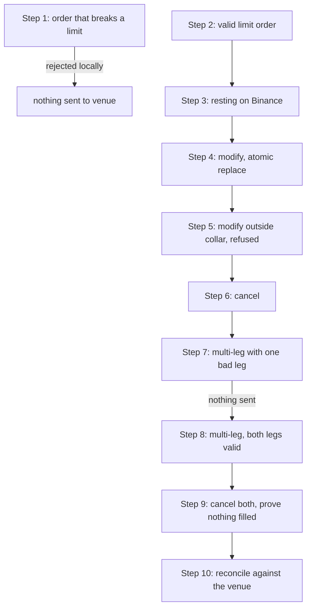

# Client Test Plan: Live Binance Spot Testnet Execution

## Purpose

Every other demo in this repository routes orders to the local
`PaperExchange`. **This plan is different: you send real, signed orders to a
real exchange matching engine** — Binance's Spot Testnet — and watch them
rest, change, and cancel on the venue.

You will verify, with your own credentials, that:

| # | Claim under test |
|---|---|
| 1 | Risk controls bind **before** anything reaches the exchange |
| 2 | A limit order can be placed and rests on the real venue |
| 3 | `modify` repositions a resting order **atomically** (no cancel-then-hope) |
| 4 | The price collar also binds on **modifications**, not just new orders |
| 5 | `cancel` removes an order and it is `CANCELED`, not silently filled |
| 6 | A multi-leg trade is **all-or-nothing**: one bad leg means *nothing* is sent |
| 7 | A valid multi-leg trade dispatches every leg **concurrently** |
| 8 | The live L2 order book renders continuously from the websocket feed |

## Safety

- Binance Spot **Testnet** uses virtual funds. **No real money is at risk.**
- Every state-changing command requires the literal flag `--confirm TESTNET`.
  Without it, nothing is transmitted.
- Production Binance URLs are rejected by configuration
  (`allow_live_trading: false` in `config.testnet.example.yaml`).
- All test orders are placed **away from the market** so they rest rather than
  fill, and the plan cancels every one of them at the end.

## Time required

About **20 minutes**, plus 5 minutes if you run the full order-book display.

---

## Step 0: Prerequisites

### 0.1 Install

```bash
git clone <repository-url> trading-platform-poc
cd trading-platform-poc
uv sync
```

> `python` may not be on your PATH. Every command below is prefixed with
> `uv run`, which uses the project's own interpreter and dependencies.

### 0.2 Create Testnet credentials

1. Go to <https://testnet.binance.vision/>.
2. Sign in with GitHub.
3. Generate an **HMAC-SHA-256** key.
4. Copy both values immediately — the secret is shown only once.

```bash
export BINANCE_TESTNET_API_KEY="your-key-here"
export BINANCE_TESTNET_API_SECRET="your-secret-here"
```

> Testnet periodically resets and **wipes all keys**. If a key that used to
> work starts failing, regenerate it — see [Troubleshooting](#troubleshooting).

**Never put these values in a file inside the repository.** They are read from
the environment by name, configured at
`config.testnet.example.yaml:13-14`.

### 0.3 Confirm connectivity

```bash
uv run hft-platform-kit --config config.testnet.example.yaml \
  binance-testnet ping

uv run hft-platform-kit --config config.testnet.example.yaml \
  binance-testnet account
```

**Expected:** `ping` succeeds, and `account` reports `"canTrade": true` with a
balance list. A stock Testnet account holds roughly **1 BTC, 1 ETH, 1 BNB and
10,000 USDT**.

> **PASS/FAIL:** if `account` returns error `-2015`, your key is not valid.
> Stop and read [Troubleshooting](#troubleshooting) — this is a credential
> problem, not a defect in the platform.

### 0.4 Set the prices you will use

Every order in this plan is placed **away from the market** so it rests
instead of filling. Rather than doing the arithmetic by hand, paste this
block once — it defines a `px` helper and fills in four shell variables that
the rest of the plan uses literally.

```bash
px() {
  uv run hft-platform-kit --config config.testnet.example.yaml \
    binance-testnet ticker --symbol "$1" 2>/dev/null \
  | uv run python -c "import json,sys
from decimal import Decimal
p=Decimal(json.load(sys.stdin)['price'])
print((p*Decimal(sys.argv[1])).quantize(Decimal('0.01')))" "$2"
}

BTC_PRICE=$(px BTCUSDT 0.995)   # 0.5% below mid  -- rests
BTC_NEAR=$(px BTCUSDT 0.997)    # 0.3% below mid  -- for the modify
BTC_FAR=$(px BTCUSDT 0.983)     # 1.7% below mid  -- outside the collar
ETH_PRICE=$(px ETHUSDT 0.995)   # 0.5% below mid  -- rests

echo "BTC_PRICE=$BTC_PRICE BTC_NEAR=$BTC_NEAR BTC_FAR=$BTC_FAR ETH_PRICE=$ETH_PRICE"
```

**Expected:** four prices, for example
`BTC_PRICE=62500.39 BTC_NEAR=62613.31 BTC_FAR=61734.09 ETH_PRICE=1848.72`.

> Copy the commands below **exactly as written**, including the `$` signs.
> They are real shell variables, not placeholders to substitute by hand.
> If a command reports `has a non-numeric field`, the variables are not set
> in this terminal — re-run the block above.
>
> Prices move. If you take a long break, re-run the block before continuing,
> or an order intended to rest may fill or breach the collar.

---

## The lifecycle you are about to exercise



---

## Step 1: Prove the risk engine binds before the exchange

Ask for a size larger than the configured notional limit of 1,000 USDT.

```bash
uv run hft-platform-kit --config config.testnet.example.yaml \
  binance-testnet submit \
  --symbol BTCUSDT --side buy --type limit \
  --quantity 0.05 --price "$BTC_PRICE" \
  --daily-net-pnl 0 --confirm TESTNET
```

At a mid near 63,000 that is about 3,145 USDT of notional — comfortably
affordable from your 10,000 USDT, but over the limit.

**Expected output:**

```text
hft-platform-kit: error: risk rejected order: max_order_notional
```

**PASS criteria:**

- The command exits non-zero with a **named** reason (`max_order_notional`).
- Nothing appears in `open-orders`.

This is the important part: the order was refused by *our* risk engine, so no
message was ever sent to Binance. Confirm that:

```bash
uv run hft-platform-kit --config config.testnet.example.yaml \
  binance-testnet open-orders --symbol BTCUSDT
```

**Expected:** `[]` — an empty list.

> Size matters here. If you ask for something you genuinely cannot afford
> (say `--quantity 5`, about 315,000 USDT), you get a different and earlier
> error, `insufficient USDT Testnet balance`, because the balance check runs
> before risk evaluation. That is also correct behaviour — it is just not the
> control this step is meant to demonstrate.

---

## Step 2: Place a real order

```bash
uv run hft-platform-kit --config config.testnet.example.yaml \
  binance-testnet submit \
  --symbol BTCUSDT --side buy --type limit \
  --quantity 0.001 --price "$BTC_PRICE" \
  --daily-net-pnl 0 --confirm TESTNET
```

**Expected (abridged, from a real run):**

```json
{
  "binance": {
    "symbol": "BTCUSDT",
    "order_id": 22888208,
    "client_order_id": "poc-...",
    "status": "NEW",
    "side": "BUY",
    "order_type": "LIMIT",
    "price": "62946.40000000"
  },
  "oms_order": { "state": "acknowledged" }
}
```

**PASS criteria:**

- `status` is `NEW`.
- `oms_order.state` is `acknowledged` — our internal state machine agrees with
  the venue.
- **Record the `order_id`.** Set it as a shell variable so the later steps
  paste cleanly, substituting the number you actually got:

```bash
ORDER_ID=22888208
```

> Want to check the plumbing without creating anything? Replace
> `--confirm TESTNET` with `--test-only`. Binance validates the order against
> its real filters and returns `binance_test_order_accepted`, but no order is
> created.

---

## Step 3: See it resting on the venue

```bash
uv run hft-platform-kit --config config.testnet.example.yaml \
  binance-testnet open-orders --symbol BTCUSDT
```

**Expected:** exactly one entry, matching `ORDER_ID`, `"status": "NEW"`,
`"original_quantity": "0.00100000"`.

This is read back **from Binance**, not from our memory.

---

## Step 4: Modify it atomically

Reprice to `$BTC_NEAR` (0.3% below mid) and resize from `0.001` to `0.002` in a
single operation.

```bash
uv run hft-platform-kit --config config.testnet.example.yaml \
  binance-testnet modify \
  --symbol BTCUSDT --cancel-order-id "$ORDER_ID" \
  --side buy --type limit \
  --quantity 0.002 --price "$BTC_NEAR" \
  --daily-net-pnl 0 --confirm TESTNET
```

**Expected (from a real run):** a **new** `order_id` (e.g. `22888217`), status
`NEW`, `original_quantity` `0.00200000`, at the new price.

**PASS criteria:**

- A new venue order id is returned; **record it as `NEW_ORDER_ID`**, again
  substituting the number you actually got:

```bash
NEW_ORDER_ID=22888217
```

- `open-orders` now shows **exactly one** order — the old one is gone.

```bash
uv run hft-platform-kit --config config.testnet.example.yaml \
  binance-testnet open-orders --symbol BTCUSDT
```

**Why this matters:** this uses Binance's native `cancelReplace` with
`STOP_ON_FAILURE`, so you can never end up holding two live orders or zero.
See `src/trading_platform_poc/binance_execution.py:573`.

---

## Step 5: Prove the collar binds on modifications too

Now try to reprice the order far away from the market — `$BTC_FAR`, which is
1.7% below mid and therefore outside the 1% collar.

```bash
uv run hft-platform-kit --config config.testnet.example.yaml \
  binance-testnet modify \
  --symbol BTCUSDT --cancel-order-id "$NEW_ORDER_ID" \
  --side buy --type limit \
  --quantity 0.002 --price "$BTC_FAR" \
  --daily-net-pnl 0 --confirm TESTNET
```

**Expected output:**

```text
hft-platform-kit: error: risk rejected replacement: price_collar
```

**PASS criteria:**

- The replacement is refused by name (`price_collar`).
- The **original order is untouched** and still resting — a refused
  modification must not destroy the order you already had.

```bash
uv run hft-platform-kit --config config.testnet.example.yaml \
  binance-testnet open-orders --symbol BTCUSDT
```

**Expected:** still exactly one order, still `NEW_ORDER_ID`.

---

## Step 6: Cancel it

```bash
uv run hft-platform-kit --config config.testnet.example.yaml \
  binance-testnet cancel \
  --symbol BTCUSDT --order-id "$NEW_ORDER_ID" --confirm TESTNET
```

Then confirm the venue agrees:

```bash
uv run hft-platform-kit --config config.testnet.example.yaml \
  binance-testnet query --symbol BTCUSDT --order-id "$NEW_ORDER_ID"
```

**Expected:** `"status": "CANCELED"` and `"executedQty": "0.00000000"`.

**PASS criteria:** the order is **`CANCELED`, not `FILLED`**. Disappearing
from `open-orders` alone is not sufficient evidence — a filled order also
disappears. Always confirm with `query`.

---

## Step 7: Multi-leg — one bad leg means nothing is sent

This is the headline behaviour. Submit two legs where the **first is perfectly
valid** and the second breaks a limit.

```bash
uv run hft-platform-kit --config config.testnet.example.yaml \
  binance-testnet multi-leg \
  --leg "BTCUSDT:buy:limit:0.001:$BTC_PRICE" \
  --leg "ETHUSDT:buy:limit:5:$ETH_PRICE" \
  --daily-net-pnl 0 --confirm TESTNET
```

(`5` ETH is roughly 9,300 USDT of notional, well over the 1,000 limit.)

**Expected output:**

```text
hft-platform-kit: error: risk rejected leg ETHUSDT: max_order_notional
```

**PASS criteria — the critical assertion of this whole plan:**

```bash
uv run hft-platform-kit --config config.testnet.example.yaml \
  binance-testnet open-orders --symbol BTCUSDT
uv run hft-platform-kit --config config.testnet.example.yaml \
  binance-testnet open-orders --symbol ETHUSDT
```

**Both must return `[]`.** The valid BTC leg was **never transmitted**,
because admission is atomic: every leg is checked and reserved *before* any
leg is dispatched. A partially-executed multi-leg trade leaves unhedged
exposure, which is exactly what this prevents.

---

## Step 8: Multi-leg — both legs valid

```bash
uv run hft-platform-kit --config config.testnet.example.yaml \
  binance-testnet multi-leg \
  --leg "BTCUSDT:buy:limit:0.001:$BTC_PRICE" \
  --leg "ETHUSDT:buy:limit:0.01:$ETH_PRICE" \
  --daily-net-pnl 0 --confirm TESTNET
```

**Expected (from a real run):**

```json
{
  "admission": {
    "all_legs_admitted": true,
    "legs": 2,
    "required_balances": { "USDT": "81.55709" }
  },
  "dispatch": { "concurrent": true, "failed_legs": 0 }
}
```

**PASS criteria:**

- `all_legs_admitted` is `true` and `failed_legs` is `0`.
- `required_balances` shows the **aggregated** cost of *both* legs, proving
  affordability was evaluated for the trade as a whole rather than leg by leg.
- `concurrent` is `true` — the legs were dispatched together, not in sequence.
- Both symbols now show one resting order each. **Record both order ids**
  from `dispatch.results[].binance.order_id`, substituting your own numbers:

```bash
BTC_ORDER_ID=22888289
ETH_ORDER_ID=17694714
```

---

## Step 9: Clean up and prove nothing filled

```bash
uv run hft-platform-kit --config config.testnet.example.yaml \
  binance-testnet cancel --symbol BTCUSDT --order-id "$BTC_ORDER_ID" \
  --confirm TESTNET

uv run hft-platform-kit --config config.testnet.example.yaml \
  binance-testnet cancel --symbol ETHUSDT --order-id "$ETH_ORDER_ID" \
  --confirm TESTNET
```

Verify each one explicitly:

```bash
uv run hft-platform-kit --config config.testnet.example.yaml \
  binance-testnet query --symbol BTCUSDT --order-id "$BTC_ORDER_ID"

uv run hft-platform-kit --config config.testnet.example.yaml \
  binance-testnet query --symbol ETHUSDT --order-id "$ETH_ORDER_ID"
```

**Expected for both:** `"status": "CANCELED"`, `"executedQty": "0.00000000"`.

**PASS criteria:** both `CANCELED` with zero executed quantity, and
`open-orders` empty for both symbols. Your Testnet balances are unchanged from
where you started.

---

## Step 10: Reconcile local state against the venue

```bash
uv run hft-platform-kit --config config.testnet.example.yaml \
  binance-testnet reconcile --symbol BTCUSDT
```

**Expected:** a snapshot of account balances, open orders, and recent trades
read from Binance, for comparison against our internal OMS view.

---

## Step 11: Live L2 order book

Render a continuously updating depth ladder from the websocket feed. This uses
the **public** Binance venue (`config.yaml`), which has a far deeper and busier
book than Testnet, so the display is much more convincing.

```bash
uv run hft-platform-kit book --symbol BTCUSDT --depth 10 \
  --duration-seconds 300 2>/dev/null
```

**Expected:** a redrawing bid/ask ladder with mid price, spread in bps, level
counts, and a feed-health indicator, running for five minutes.

**PASS criteria:**

- `feed` shows `HEALTHY`.
- Level counts are in the hundreds or low thousands per side.
- `spread` is small and positive; the top of book visibly moves.

> `2>/dev/null` hides structured log lines, which are written to stderr by
> design, leaving a clean display. Press `Ctrl-C` to stop early. Add `--json`
> to emit one JSON object per refresh instead of a table.

---

## Pass/fail checklist

Hand this back to us completed.

| Step | What must be true | Pass? |
|---|---|---|
| 0.3 | `account` shows `canTrade: true` | ☐ |
| 1 | Oversized order rejected `max_order_notional`, `open-orders` empty | ☐ |
| 2 | Order accepted, `status NEW`, `oms_order.state acknowledged` | ☐ |
| 3 | Order visible in `open-orders` read back from Binance | ☐ |
| 4 | `modify` returns a new id; exactly one order remains | ☐ |
| 5 | Far-from-market `modify` rejected `price_collar`; original intact | ☐ |
| 6 | `query` reports `CANCELED` with `executedQty 0` | ☐ |
| 7 | Bad leg rejected **and** the good leg never reached the venue | ☐ |
| 8 | Both legs admitted, `concurrent true`, aggregated `required_balances` | ☐ |
| 9 | Both orders `CANCELED`, zero executed, balances unchanged | ☐ |
| 11 | Order book renders for 5 minutes with `feed HEALTHY` | ☐ |

---

## Troubleshooting

### `-2015 Invalid API-key, IP, or permissions`

Your key is not recognised. This is **not** a signing bug. Binance validates
the key *before* the signature: a valid key with a wrong secret returns
`-1022`, not `-2015`.

Most common cause: **Testnet periodically resets and deletes all keys.**
Regenerate at <https://testnet.binance.vision/> and re-export both variables.

Also check you exported both variables **in the shell you are running from** —
each new terminal needs them again.

### `risk rejected order: max_net_position`

The risk `position` is derived from your **total** balance of the base asset,
not from a flat book (`src/trading_platform_poc/binance_cli.py:265`). Testnet
grants you about 1 BTC, so a `max_net_position` below that rejects every
order. `config.testnet.example.yaml` ships with `2`, which accommodates the
grant. If you trade an asset Testnet funds more generously — XRP and TRX
arrive in the hundreds or thousands — raise it to suit.

### `risk rejected order: price_collar`

Your limit price is more than 1% away from the mid. That is deliberate
fat-finger protection. Move the price closer, or raise `price_collar_bps` in
the config if your use case genuinely needs it.

### `leg '...' has a non-numeric field`

The price in the leg is not a number — almost always because the shell
variables from [Step 0.4](#04-set-the-prices-you-will-use) are not set in the
terminal you are using. Each new terminal needs the `px` block again. Check
with `echo "$BTC_PRICE $ETH_PRICE"`; if it prints an empty line, re-run the
block.

Copy the commands exactly as printed, keeping the `$` signs. They are real
shell variables, not names to replace by hand.

### `each leg must use a distinct symbol`

`multi-leg` requires one leg per symbol. Use `BTCUSDT` and `ETHUSDT` rather
than two `BTCUSDT` legs.

### `python: command not found`

Use `uv run` in front of every command, as shown throughout this plan.

### `timeout: command not found`

`timeout` does not exist on macOS. Use the built-in `--duration-seconds`
option instead of wrapping commands in `timeout`.

---

## What this plan does *not* prove

Stated plainly, so the scope is not overread:

- **Latency.** Testnet is not a performance environment. No timing claim here
  is representative of production.
- **Fills.** Every order is deliberately placed away from the market so it
  rests. Fill handling and hedging are covered by the paper-trading demo in
  `CLIENT_DEMO_RUNBOOK.md`.
- **Production trading.** `allow_live_trading` is `false` and production
  Binance URLs are rejected by configuration.

## Related pages

- `CLIENT_DEMO_RUNBOOK.md` — the full guided demonstration
- `DEMO_PLAN.md` — Annex A, the engineer-facing walkthrough of these features
- `EXECUTION_CONTROLS.md` — how the controls and precedence hierarchy work
- `README.md` — command reference
