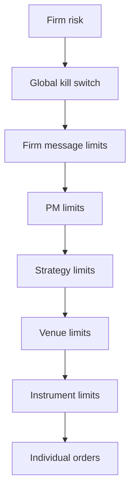
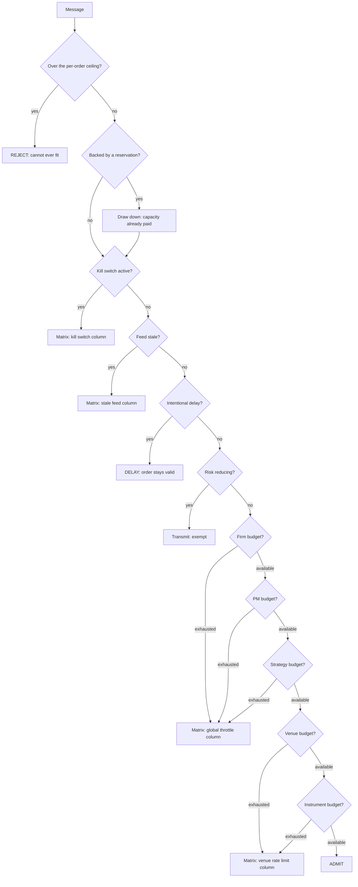

# Execution Controls

How every outbound message is checked against venue rate limits, the
firm-wide throttle, market-data staleness, and the kill switch — with a
deterministic precedence order, so the same inputs always produce the
same decision.

Implemented in `src/trading_platform_poc/execution_controls.py` and
demonstrated by `src/trading_platform_poc/controls_demo.py`. Covered by
`tests/test_execution_controls.py` (296 tests) and
`tests/test_controls_demo.py` (14 tests).

Run it offline, on any operating system, with no credentials:

```bash
trading-platform-poc controls-demo --scenario all
```

## Why this exists

Controls that each make sense alone can contradict each other in
combination. If a venue rate limit says "queue" and the kill switch says
"reject", something has to decide, and it must decide the same way every
time — including at 3am, in a replay, and in front of a regulator.

Two rules make that possible:

1. **The matrix decides what a binding control does.** It is published as
   data, not scattered through branches.
2. **The hierarchy decides which control binds.** Evaluation walks from
   the most senior control downward and stops at the first one that
   applies, so two controls can never disagree about an outcome.

## Control-to-order-state matrix

Encoded literally as `CONTROL_MATRIX`, so it can be exported, diffed and
asserted against. Every one of these 40 cells has a dedicated test.

The three other decision tables are published the same way, and all four
are exported from the `hft_platform_kit` SDK:

| Table | What it fixes |
| --- | --- |
| `CONTROL_MATRIX` | Required behaviour for each order state under each control |
| `CONTROL_PRECEDENCE` | The order controls are evaluated in, and the authority each carries |
| `EXEMPT_PRIORITIES` | The priorities a capacity control may never block |
| `RISK_REDUCING_STAGES` | The order states that only ever reduce exposure |

A reviewer can therefore reproduce every transition from data rather
than by reading the evaluator.

| Order state | Venue rate limit | Global throttle | Stale feed | Kill switch |
| --- | --- | --- | --- | --- |
| New (not admitted) | queue | queue | reject | reject |
| Risk approved, waiting | queue | queue | cancel admission | cancel admission |
| Sent, awaiting ACK | monitor | monitor | monitor | cancel |
| Resting | monitor | monitor | cancel | mass cancel |
| Partial fill | monitor | hedge only | hedge only | hedge only |
| Filled, awaiting hedge | admit | admit | admit | admit |
| Replace request | queue | queue | reject | cancel |
| Cancel request | admit | admit | admit | admit |
| Emergency hedge | admit | admit | admit | admit |
| Forced liquidation | n/a | n/a | admit | admit |

The bottom four rows are the important ones: **anything that reduces
exposure is never blocked**. A throttle that prevents a hedge converts a
capacity problem into a position problem.

## Control hierarchy



Higher-level controls always override lower-level ones. A strategy owner
may tighten their own limits but cannot loosen a PM, firm, or kill-switch
control. Only a named risk administrator can clear a kill switch.

Because the firm message limit outranks any single venue's, a message
blocked by both is reported as a firm-throttle event — the more senior
cause is the one an operator needs to see.

## Evaluation order



The per-order ceiling (`max_messages_per_order`) is checked *before* the
walk. An order larger than any window could ever carry is rejected
synchronously rather than queued, because queueing it would promise a
transmission that can never happen.

A message backed by a live reservation skips the **capacity** controls —
it paid for them at reserve time, and charging again would spend the
budget twice. It does not skip the kill switch or the stale-feed check:
reserving capacity is not a licence to trade on stale prices.

The PM, strategy and instrument tiers are optional. An unconfigured tier
does not exist and never binds, which is why enabling them changes
nothing for a deployment that does not use them.

## Reject vs queue vs delay

These are three different things and the platform keeps them distinct,
because they mean different things to the caller.

| Outcome | Reaches the venue | Meaning |
| --- | --- | --- |
| **Synchronous rejection** | never | Refused before entering the OMS. No exchange message is generated. The caller is told immediately. |
| **Queue** | later, or never | Accepted internally, held for capacity, then sent — or expired if its deadline passes first. |
| **Delay** | later | Intentionally postponed by an external event such as an auction or volatility interruption. The order remains valid. |

Two things are rejected up front rather than queued, on the same
principle: queueing a message that cannot be released only hides the loss
until it silently expires.

| Refused because | Why waiting cannot help |
| --- | --- |
| Its deadline falls *before* capacity returns | The window rolls too late for this message. |
| It is larger than its class's *entire* share | An empty budget refuses it too. A research order for 7 messages against a firm budget of 10 can never fit the 60% it is allowed, at any level of utilisation. |

The second is not the same as congestion, and the distinction is load
bearing: a request that merely has to *wait* is still queued. The one
exception is a single message against a budget too small to hold one —
60% of a budget of one is 0.6, so by size alone it "exceeds" its share,
but a single message on an untouched budget is always admitted and
waiting genuinely does work.

### How the drain scan handles a short budget

`drain()` walks the queue in priority order and each message returns one
of three verdicts. The distinction matters because the wrong one either
inverts priority or stalls unrelated traffic.

| Verdict | Raised when | Effect on the scan |
| --- | --- | --- |
| `TAKE` | Every tier covered the message. | Released. |
| `SKIP` | A *scoped* tier refused — the message's own venue or instrument. | Scan past it. A different venue may still be releasable, so one busy venue must not stall the firm. |
| `STOP` | A *shared* tier refused — firm, PM or strategy. | Nothing behind it drawing on the **same** budget can go either; scanning on would hand that budget's last slot to strictly lower-priority traffic. |

A message that is larger than its class's whole share is the exception:
it is downgraded to `SKIP`, because it says nothing about the budget's
capacity and must not stall the scan on the budget's behalf. Admission
rejects these, but the queue is a public object and a caller may push one
directly.

`STOP` carries the key of the budget that refused, and the scope is the
whole point:

- **Firm** — reported with an empty key and ends the scan outright.
  Every queued message draws on the firm budget, so there is nothing
  behind it that could go.
- **PM or strategy** — reported with that budget's key. The scan records
  the key and *continues*. A strategy budget is shared only by that
  strategy's messages; ending the scan on its behalf would idle every
  other strategy in the queue — the same head-of-line block `SKIP`
  exists to prevent, one scope up.

Recorded keys are consulted for the rest of the scan, so a smaller
message in an already-blocked scope is refused without touching the
budget. Without that, the scan would reach it, find the one free slot
that was too small for the message ahead of it, and reintroduce exactly
the inversion the `STOP` was raised to prevent.

## Atomic reservation

Before the first leg of a multi-leg opportunity is transmitted,
`ReservationLedger.reserve()` takes **everything at once** under a single
lock:

- per-venue message capacity for every planned message
- firm-wide message capacity, including the hedge
- the PM, strategy and instrument tiers the opportunity will spend
- notional, margin, and position limits

If any component fails, everything already taken is released and no order
is transmitted. This is the control that prevents the worst outcome in
multi-leg trading: one leg executing while the other cannot be sent.

Hedge capacity is reserved **up front**, so a hedge is never the message
that has nowhere to go. Because the hedge is charged to its venue
unconditionally — nothing may block a hedge — the hedge allowance is
offered *only* to risk-reducing traffic. Handing it to an ordinary order
would let one opportunity walk straight through a venue's hard limit.

A reservation is an authorisation, not a bearer token. It is honoured
only for the strategy and instrument it was granted to. A message that
skips the capacity walk skips *its own* tiers, so a mismatched message
falls through to the normal walk and pays its own way.

A spread is two instruments, not one. `ReservationRequest` therefore
takes `venue_instruments` — per-leg overrides — and each instrument tier
is charged only for the legs that actually trade it.

```bash
trading-platform-poc controls-demo --scenario atomic-reservation
```

The demo shows venue allowances byte-identical before and after a failed
reservation (`"rollback_was_complete": true`).

### "Under a single lock" is asserted, not assumed

Every claim above rests on a lock, and a lock is invisible: delete one
and the suite still passes, the demo still prints the same JSON, and the
damage only appears under production concurrency. Eleven of the locks in
this module are therefore held by tests that fail deterministically if
the acquisition is removed:

| Removed | What escapes |
| --- | --- |
| `MessageBudget.try_reserve` | Two threads take the last slot; two messages go to a venue that allowed one |
| `MessageBudget.try_reserve_within` | A class is admitted past its priority ceiling, spending headroom reserved for higher-priority traffic |
| `MessageBudget.release` | A release is lost, so the allowance shrinks permanently and never refills |
| `MessageBudget.consume_reserved` | A spend is lost, so the next window over-admits by that much |
| `MessageBudget.force_consume` | A hedge that reached the exchange vanishes from the overage record |
| `ReservationLedger.reserve` | One opportunity reserved twice: two reservations, capacity charged twice, notional counted twice |
| `ReservationLedger.consume` | Two legs spend the same reserved message, so the opportunity sends more than it reserved |
| `ReservationLedger.consume_hedge` | Two unwind legs spend one reserved hedge message, and the extra is taken out of another opportunity's hedge reservation |
| `ReservationLedger.release` | Two opportunities closing together strand notional, and every later opportunity is measured against a limit short by that amount |
| `PriorityMessageQueue` pop/drain | The same queued message is transmitted twice |

One caution the table cannot show: a lock protects what it excludes,
and `ReservationLedger.reserve`'s lock excludes other *reservations*.
It does not exclude `ExecutionControlPlane.evaluate()`, which never
takes it and spends the same budget objects. Reading "this runs under
the ledger lock" as "this is safe" is how the ceiling race survived
there after being fixed elsewhere.

These do not sample interleavings and hope. Two threads are parked
inside the critical section at the seam between reading a value and
acting on it, so the race is forced rather than gambled on. That
matters: the original check-then-act admission bug lost 54 trials in 60
and was caught easily, but the window left by deleting a lock is a few
bytecodes wide, and seventy-five stress trials never caught it once.

Each test also asserts *who arrived* at the seam. Proving no two threads
were ever inside together is worthless if the harness never got them
there — a setup call that quietly spends the rendezvous leaves a test
that cannot fail no matter what the code does, which is exactly what
happened to the first draft of the spend test.

The locks not on this list are read-only accessors, telemetry counters,
and snapshot builders. Losing one costs a count or a torn dashboard
reading, not a control decision. They are listed as known survivors by
the sweep below rather than quietly ignored.

### A lock on each step is not a lock on the pair

Every individual budget operation was already atomic, and the priority
ceiling was still breachable. Admission reads the ceiling in `_binds`
and takes the capacity later in `_reserve_capacity`; both steps locked,
the gap between them not. Two research messages that each read "still
below the ceiling" both reserved, and the class ended up holding six
against a share of five.
The hard limit never catches this, because being over a 50% ceiling is
nowhere near being over the budget — the compare-and-increment that
protects the limit is no help at all. What the overshoot costs is the
headroom being held for higher-priority traffic, which is ultimately the
capacity an emergency hedge is promised, taken by the lowest-priority
class on the system.

`MessageBudget.try_reserve_within()` folds the ceiling test and the
reservation into one acquisition, and both the admission path and the
drain path use it. The lock is re-entrant, so this costs nothing. A
message refused there falls into the same "capacity disappeared"
fallback that already existed for the hard limit, so it is queued or
rejected with the reason the control matrix prescribes.

#### Grep finds names, not shapes

The pair appeared in **three** places. Grepping for `above_ceiling`
found two of them. The third — `ReservationLedger.reserve()` — never
names the method: it goes through `self._check_ceiling(budget, …)`, so
a name-based search cannot see it, and the fix shipped looking
complete while a third of the defect was still live.

That site was also the worst of the three. The ledger holds its own
lock across a reservation, which looks like protection until you ask
who it excludes: the party racing a reservation is
`ExecutionControlPlane.evaluate()`, which never takes the ledger lock
— and both spend the *same* `MessageBudget` objects, because the plane
hands its own budgets to the ledger it builds. A reservation is also
the one call that can take a whole budget at once, so a ceiling a
reservation can straddle is a ceiling any caller can evade by
reserving first.

`ReservationLedger._take()` now folds the pair for all three of the
ledger's own sites. The lesson generalises past this defect: a
name-based search enumerates *callers of a name*, not *instances of a
shape*, and a check-then-act pair is a shape.

`tests/test_execution_controls_shape.py` enumerates the shape instead.
It parses the module, resolves the delegation that hid the third site
-- `self._check_ceiling(budget, ...)` is a read on `budget`, not on
`self` -- and reports every place an advisory answer is read and
something is then done to the same object. Two pairs exist today and
both are listed in a frozen baseline with the reason each is safe.

Three things make it worth having rather than reassuring:

- **It fails in both directions.** A new pair is a failure, not a
  report, because the entire lesson of this defect is that the shape
  looks correct at every site and a report nobody must read will not
  be read. An entry *disappearing* is also a failure: an allowlist
  that has silently gone stale is worse than none.
- **It is keyed on names, never line numbers** -- `(function,
  receiver, advisory method, what followed)`. A baseline that churns
  whenever code moves gets deleted within a month.
- **It has a positive control.** The test re-splits the fix in a copy
  of the source and asserts the enumerator finds the damage. Without
  it, an enumerator that quietly stopped working would keep passing
  by finding nothing -- which has happened to more than one check in
  this project.

The detector's scope is one frame, and that is a decision rather than
a limit. The invariant has two clauses — an advisory read must be
paired either with an authoritative call *in the same acquisition*, or
with a *handler for that call's refusal* — and only the first is a
shape. The second is behaviour, so it belongs to the suite. The
module's one instance of it is `_draw_down`, which catches
`CapacityReservationError` and falls back to charging the message
normally when the reservation it meant to spend was released in the
gap. That handler is now held by
`test_a_reservation_released_mid_spend_still_admits`, which parks
inside the spend and releases the reservation from a second thread.
Deleting the handler used to fail nothing at all — every other test
spends a reservation that is still there — and the consequence was a
control plane that raises instead of deciding.

Making the detector cross frames would have found that site and then
reported that a handler exists, which was already true and already
insufficient, at the cost of exactly the complexity where a detector
fails silently.

Each baselined exception names **the test that holds it**, and a guard
checks that test still exists. The reason is that an entry is keyed on
names only, with no reference to the body it describes, so the key does
not move when that body changes. The danger is not somebody adding a
bad exception; it is a good one's justification quietly ceasing to be
true while the entry looks identical.

The two current entries show why naming matters. Skipping the
acquisition inside `try_reserve_within` leaves its pair spelled exactly
the same, so the enumerator stays silent — that entry is held by a
concurrency test, not by this file. The `_preflight` entry is the
reverse: it is held by the enumerator itself, because inserting a take
there produces a new unbaselined pair. Each is held by a different
instrument than the one that reported it, and neither is held by prose.

What closes a class of defect is the enumerator, not the count. Two
"closed" claims here were already wrong: the name-fold class was
declared closed at 2 sites and a sweep found 9, and this one was
declared closed at 2 and there were 3. Every individual fix was
correct both times; the *enumeration* was what failed. "Have I fixed
them all" is not answerable. "Does my enumerator find them all on a
revision where I already know the answer" is, and that is the
positive control's job.

The three tests that hold this are worth reading together, because the
first two assert opposite things about contention:

- `test_two_admissions_cannot_both_clear_one_priority_ceiling` asserts
  the two threads *were* inside the ceiling read together. That read is
  advisory and they are entitled to be. Asserting it is what stops the
  test passing because the race never happened.
- `test_a_drain_and_an_admission_cannot_both_clear_one_ceiling` asserts
  they were *not*, because once the test and the take share one
  acquisition the budget lock is held across the whole decision.
- `test_a_reservation_and_an_admission_cannot_both_clear_one_ceiling`
  holds the ledger site, and had to be written twice. The first
  version passed with the fix reverted: it stopped the reserving
  thread on its *first* ceiling test, which is the advisory one in
  `_preflight`, so the reservation went on to test and take without
  ever being interrupted. Stopping it on the second call lands in the
  seam that matters. Counting calls, rather than stopping on the
  first, is what makes it honest — and the count is the same in the
  fixed and the broken source, so the test is not written to the fix.

### Finding the next one

`scripts/mutation_sweep.py` enumerates a safety idiom and removes it one
site at a time, reporting any site no test depends on:

```bash
uv run python scripts/mutation_sweep.py --list
uv run python scripts/mutation_sweep.py fold   # every name fold
uv run python scripts/mutation_sweep.py lock   # every lock acquisition
```

Both sweeps derive their site list by reading the module at run time, so
a site added later is swept automatically and a site removed cannot
leave a stale entry behind. The lock sweep selects its targets by the
`concurrency` marker for the same reason. It is a mutation harness, not
a test: it rewrites the module on disk and must not run in CI beside the
suite.

## Visibility before the breach

Operators are told a control is *approaching*, not just that it has
bound. `ExecutionControlPlane.dashboard()` reports the band, the driving
resource, queued and dropped counts, remaining capacity, affected
strategies, and expected recovery time.

| Band | Utilization | What happens |
| --- | --- | --- |
| Green | 0–60% | Nothing. |
| Yellow | 60–80% | PM notified: approaching the limit, expect queue growth and added latency. |
| Orange | 80–95% | Reduce quote refresh, suspend passive strategies, reserve hedge capacity. |
| Red | 95%+ | The control binds. Non-exempt traffic is queued or rejected; only risk-reducing traffic is guaranteed. |

Exempt traffic is still *counted* even though it is never blocked, so a
hedge storm that pushes utilization past 100% remains visible rather than
silently uncounted.

`expected_recovery_ms` is built only from tiers that are actually
**binding**. Timing every configured window would report the longest one
the firm happens to run (an idle daily budget, say) as the wait on a
completely quiet system, which reads as an outage that is not happening.

"When does the control blocking me recover?" and "who is being held back
by a ceiling?" are different questions, and one scalar answers neither.
A tier at 65% blocks nobody outright but does hold back any class whose
ceiling it has crossed; folding it into the same `max()` let an idle
daily budget claim a venue's one-second recovery was a day away. Ceiling
pressure is therefore reported separately, per tier, in `holding_back`:

| Field | Meaning |
| --- | --- |
| `name`, `level` | Which budget, and where it sits in the precedence hierarchy. |
| `utilization_pct` | Current utilization. |
| `refills_in_ms` | When this tier's own window rolls. |
| `classes_held_back` | The priority classes whose ceiling this utilization has already crossed. |

A tier appears in `holding_back` only when it is *not* binding — once it
binds it is the recovery answer, not a warning about one.

## Identity is folded once, on the way in

Every scope identifier -- venue, instrument, PM, strategy -- is
case-folded and trimmed at construction *and* at lookup, and a
`Reservation` stores the **folded** identity rather than the caller's
spelling. Storing the raw string let one reservation disagree with
itself: it charged `\x00strategy:alpha` but gated drawdown on `Alpha`,
so the drawdown never matched and the message was charged again on top
of capacity already held for it.

A missed lookup is indistinguishable from "no tier configured", and
`_binds` treats an absent optional tier as not applying -- so a case
mismatch does not delay a limit, it deletes it.

The rule is not "always fold identifiers" but **never fold a mapping
without rejecting folded duplicates**. A silent merge makes the folded
map and the caller's raw map disagree about a quantity, and the two
sides of a reserve/release pair then read it from different maps -- a
permanent capacity leak on the success path, with no error anywhere.
This applies to caller-supplied maps (`venue_messages`,
`venue_instruments`) exactly as it does to config maps, and the fold
must happen before anything is taken, or the refusal leaks what it
already took.

Duplicate spellings in a config map are a **startup error**, not a
last-wins. Two spellings of one scope means the operator believes they
configured two independent allowances, and merging them enforces less
than the config states. `strategy_pm` is held to the same rule for a
stronger reason: it selects which manager's allowance a strategy is
charged against, so discarding a routing changes an enforcement
outcome rather than which of two equivalent budget objects survives.

## Two axes of exemption, and why they differ

Risk-reducing traffic is exempt from **capacity** controls by *priority
or stage*, but from `STALE_FEED` and `KILL_SWITCH` by **stage alone**.
The asymmetry is deliberate. A capacity limit is a queueing problem, so
a hedge that has to be sent should outrank a quote refresh however it is
labelled. A stale feed is an information problem: nobody knows the true
price, so the only traffic that may proceed is traffic that provably
*reduces* exposure — which is a property of the stage, not of a label
the caller chose. Otherwise a strategy carrying no position could buy
admission on a blind market simply by marking its new orders urgent.

Concretely, under a stale feed `stage=NEW, priority=EMERGENCY_HEDGE` is
rejected while `stage=EMERGENCY_HEDGE` is admitted.

`FeedMonitor.record_tick` accepts an exchange timestamp, and never dates
a tick ahead of the local clock. A venue clock running fast would make
the age negative, and a negative age never exceeds the staleness
threshold — so the control would switch itself off for exactly the venue
it was protecting. Clamping only ever moves a stored timestamp earlier,
so age can be over-reported but never under-reported: it cannot make a
stale feed look fresh. Because a clamped venue then renders identically
to a healthy one, `FeedMonitor.clamped(venue)` counts the ticks that
were corrected, and `to_dict()` reports it per venue as
`clamped_ticks`. A non-zero count means that venue's timestamps are
unusable for measuring anything, not merely that one arrived early.

## Priority allocates capacity, not just queue position

A priority queue that only reorders what is already queued does not
*allocate* anything: a research backfill that arrives first spends the
firm budget before a market-making message is ever evaluated, and the
queue can only reorder the ones that already lost.

Each scheduling class therefore has a utilisation ceiling. Once a budget
has reached it, that class stops being admitted and the remaining
headroom is held for the classes above it.

| Class | Ceiling | Effect |
| --- | --- | --- |
| Forced liquidation, emergency hedge, risk reducing | none | Never blocked. Requirement 10 outranks the ceiling. |
| Market making | 100% | Uses the budget to the limit. |
| Quote refresh | 80% | Stops with a fifth of the budget still free. |
| Research | 60% | Stops with two fifths still free. |

A class is refused once utilisation has *reached* its ceiling, and
refused again if the request in hand would *cross* it. Both rules are
needed. Testing only the before-state lets a single request overshoot by
`messages - 1`, which is unbounded unless `max_messages_per_order` is
configured — and a reserve that only shapes flows of single messages is
not a reserve. Testing only the after-state bans every class below the
top one on a small budget, because on a limit of one a single message is
already 100% of it.

One concession reconciles them, and it is deliberately the smallest one
that works: a *single* message against an *untouched* budget is admitted
even when it crosses. Widening it to any first request is what would let
one bulk reservation take a whole budget in a single call.

The ceiling is applied in all three places a budget can be drawn on:

| Path | Why it has to be checked |
| --- | --- |
| Admission (`evaluate`) | The ordinary send path. |
| Drain (`drain`) | Otherwise the ceiling delays a message by one drain cycle and reserves nothing. |
| Reservation (`ledger.reserve`) | A reserved message draws down instead of walking the capacity controls, so a ceiling enforced only at admission is one any caller can evade by reserving first. `ReservationRequest.priority` selects the ceiling. |

Override with `priority_ceilings=` on the plane; it is forwarded to the
reservation ledger. Values are validated as percentages.

```python
plane = ExecutionControlPlane(
    venue_budgets=..., global_budget=...,
    priority_ceilings={Priority.RESEARCH: Decimal(30)},
)
```

## Kill switch

Engaging is deliberately unrestricted — anyone who believes the firm is
in trouble must be able to stop it. Clearing is restricted to named
administrators, because that is the decision that puts capital back at
risk. A kill switch constructed with no administrators is rejected
outright: one that can never be cleared is a permanent outage, not a
safety device.

While engaged: no new admissions, resting orders are mass-cancelled,
in-flight orders are cancelled where possible — and cancels, hedges, and
forced liquidation still transmit.

## Try it

```bash
trading-platform-poc controls-demo --scenario venue-rate-limit
trading-platform-poc controls-demo --scenario global-throttle
trading-platform-poc controls-demo --scenario stale-feed
trading-platform-poc controls-demo --scenario kill-switch
trading-platform-poc controls-demo --scenario atomic-reservation
trading-platform-poc controls-demo --scenario control-matrix
```

Every scenario runs against an injected clock and simulated budgets, so
output is identical on every platform and every run.

## Using it from the SDK

```python
from hft_platform_kit import (
    ExecutionControlPlane,
    FeedMonitor,
    MessageBudget,
    MessageRequest,
    OrderStage,
    Priority,
    ReservationRequest,
)

plane = ExecutionControlPlane(
    venue_budgets={
        "binance": MessageBudget(name="binance", limit=100, window_ms=1000),
        "okx": MessageBudget(name="okx", limit=60, window_ms=1000),
    },
    global_budget=MessageBudget(name="firm", limit=20_000, window_ms=1000),
    feed_monitor=FeedMonitor(stale_after_ms=100),
)

plane.feed_monitor.record_tick("binance")

decision = plane.evaluate(
    MessageRequest(
        message_id="ord-1",
        strategy_id="spread-capture",
        venue="binance",
        stage=OrderStage.NEW,
        priority=Priority.MARKET_MAKING,
    )
)

if decision.transmits:
    ...  # send it
elif decision.synchronous_rejection:
    ...  # tell the caller now; nothing was sent
```
