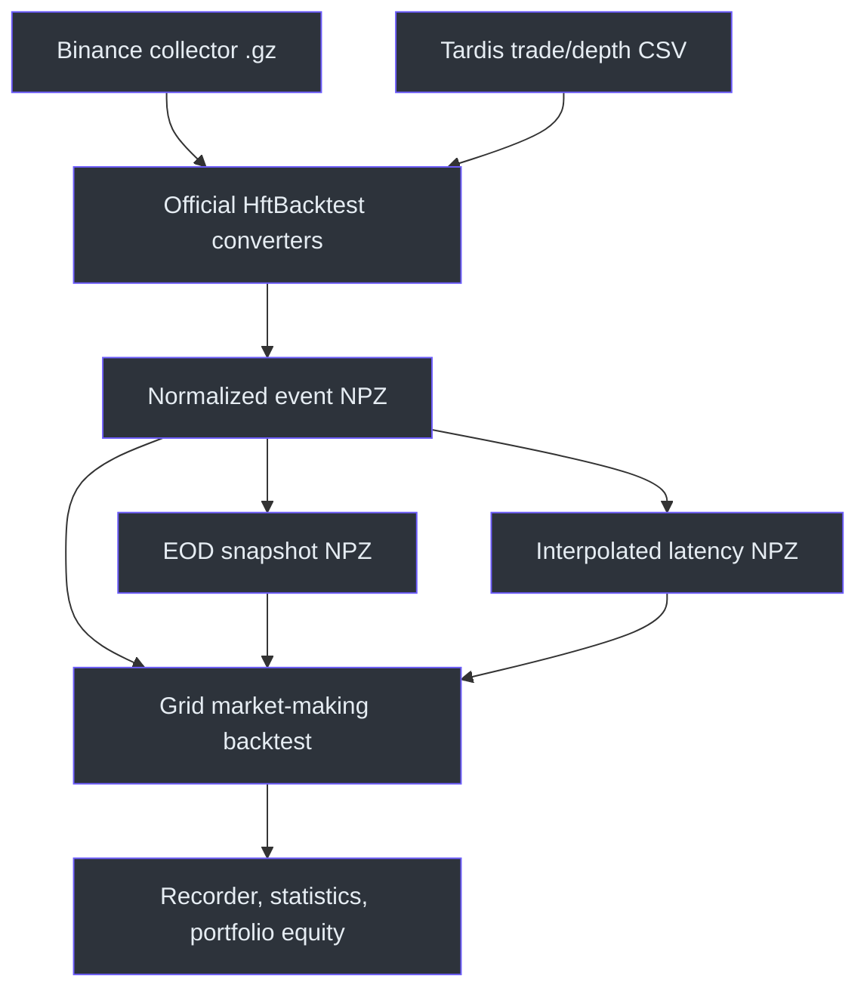
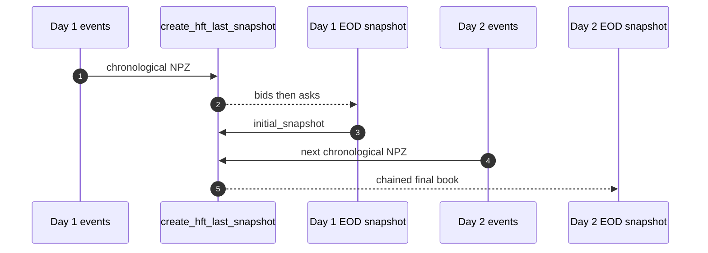
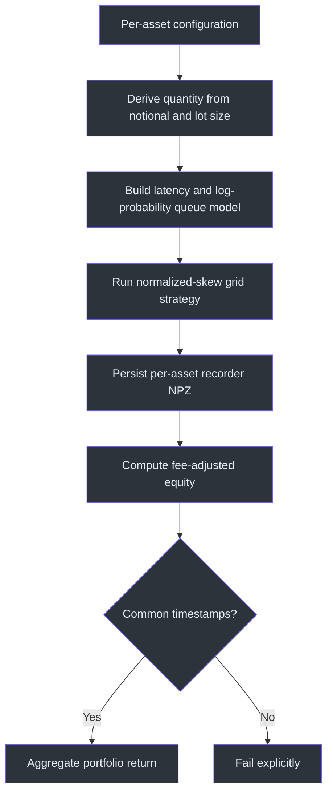

# HftBacktest Tutorial Parity Test Plan

## Overview

This plan verifies the SDK behavior added from HftBacktest's **Data
Preparation** and **High-Frequency Grid Trading** tutorials. It tests the
public CLI first, then exercises the multi-asset Python API. The implementation
keeps HftBacktest imports lazy, so the rest of the SDK remains importable on
machines where native dependencies cannot load
([optional_dependencies.py:58-123](https://github.com/ankurarrah/hft-platform-kit/blob/main/src/trading_platform_poc/optional_dependencies.py#L58-L123)).

| Area | What this plan proves | Primary source |
| --- | --- | --- |
| Binance Futures conversion | Raw collector gzip is normalized with HftBacktest's converter options | [hftbacktest_market_making.py:418-442](https://github.com/ankurarrah/hft-platform-kit/blob/main/src/trading_platform_poc/hftbacktest_market_making.py#L418-L442) |
| Tardis conversion | Trades are passed before depth and snapshot policy is explicit | [hftbacktest_market_making.py:445-476](https://github.com/ankurarrah/hft-platform-kit/blob/main/src/trading_platform_poc/hftbacktest_market_making.py#L445-L476) |
| Snapshot and latency | Multi-day EOD chaining and feed-derived order latency produce reusable NPZ files | [hftbacktest_market_making.py:479-563](https://github.com/ankurarrah/hft-platform-kit/blob/main/src/trading_platform_poc/hftbacktest_market_making.py#L479-L563) |
| Grid strategy | Price grids, normalized inventory skew, recorder output, and statistics execute together | [hftbacktest_market_making.py:807-894](https://github.com/ankurarrah/hft-platform-kit/blob/main/src/trading_platform_poc/hftbacktest_market_making.py#L807-L894) |
| Multi-asset portfolio | Tutorial parameters are derived per asset and combined into portfolio equity | [hftbacktest_market_making.py:897-960](https://github.com/ankurarrah/hft-platform-kit/blob/main/src/trading_platform_poc/hftbacktest_market_making.py#L897-L960) |


<!-- Sources: src/trading_platform_poc/hftbacktest_market_making.py:418, src/trading_platform_poc/hftbacktest_market_making.py:445, src/trading_platform_poc/hftbacktest_market_making.py:479, src/trading_platform_poc/hftbacktest_market_making.py:807 -->

## Prerequisites

| Requirement | Check |
| --- | --- |
| Repository | `cd /root/hft-platform-kit` |
| Dependencies | `uv sync --group dev` |
| HftBacktest | `uv run hft-platform-kit hft-health` |
| Optional real Binance input | `export BINANCE_RAW_GZ=/absolute/path/to/feed.gz` |
| Optional real Tardis inputs | `export TARDIS_TRADES=/absolute/path/to/trades.csv.gz` and `export TARDIS_DEPTH=/absolute/path/to/incremental_book_L2.csv.gz` |

Create an isolated output directory:

```bash
export HFT_TEST_DIR=/tmp/hftbacktest-tutorial-test
mkdir -p "$HFT_TEST_DIR"
```

**Pass:** `hft-health` reports the installed HftBacktest version and no import
error.

## 1. Run the Automated Regression Suite

The focused tests cover split exchange/local event ordering, official
converter arguments, snapshot construction, multi-file latency, plot-capable
statistics, recorder persistence, and portfolio equity
([test_hftbacktest_market_making.py:52-135](https://github.com/ankurarrah/hft-platform-kit/blob/main/tests/test_hftbacktest_market_making.py#L52-L135),
[test_hftbacktest_market_making.py:256-390](https://github.com/ankurarrah/hft-platform-kit/blob/main/tests/test_hftbacktest_market_making.py#L256-L390)).

```bash
uv run pytest -q \
  tests/test_hftbacktest_market_making.py \
  tests/test_optional_dependencies.py \
  tests/test_cli_config.py
```

**Pass:** all selected tests pass.

## 2. Generate Deterministic Tutorial Data

The CLI routes these commands through the same public functions used by SDK
callers
([cli.py:137-286](https://github.com/ankurarrah/hft-platform-kit/blob/main/src/trading_platform_poc/cli.py#L137-L286),
[cli.py:427-537](https://github.com/ankurarrah/hft-platform-kit/blob/main/src/trading_platform_poc/cli.py#L427-L537)).

```bash
uv run hft-platform-kit hft-synthetic \
  --output-dir "$HFT_TEST_DIR/btc" \
  --duration-seconds 900 \
  --events-per-second 10 \
  --mid-price 60000 \
  --tick-size 0.1 \
  --lot-size 0.001 \
  --volatility-bps-per-sqrt-second 12 \
  --trade-probability 0.8 \
  --seed 42

uv run hft-platform-kit hft-synthetic \
  --output-dir "$HFT_TEST_DIR/eth" \
  --duration-seconds 900 \
  --events-per-second 10 \
  --mid-price 3000 \
  --tick-size 0.01 \
  --lot-size 0.001 \
  --volatility-bps-per-sqrt-second 12 \
  --trade-probability 0.8 \
  --seed 43
```

**Pass:** each JSON result reports positive depth and trade event counts, and
each directory contains data, initial snapshot, and preview files. The active
profile intentionally uses more volatility and trades than the default smoke
profile so the grid crosses resting quotes and produces finite performance
ratios.

## 3. Build Feed-Derived Latency

```bash
uv run hft-platform-kit hft-latency \
  --data "$HFT_TEST_DIR/btc/synthetic_btcusdt.npz" \
  --output "$HFT_TEST_DIR/btc/latency.npz"

uv run hft-platform-kit hft-latency \
  --data "$HFT_TEST_DIR/eth/synthetic_btcusdt.npz" \
  --output "$HFT_TEST_DIR/eth/latency.npz"
```

The generated rows satisfy `request timestamp < exchange receipt < response
timestamp`; the asset builder accepts one or several latency paths
([hftbacktest_market_making.py:506-563](https://github.com/ankurarrah/hft-platform-kit/blob/main/src/trading_platform_poc/hftbacktest_market_making.py#L506-L563),
[hftbacktest_market_making.py:565-628](https://github.com/ankurarrah/hft-platform-kit/blob/main/src/trading_platform_poc/hftbacktest_market_making.py#L565-L628)).

**Pass:** both commands report a positive `sample_count`.

## 4. Build and Chain Market-Depth Snapshots


<!-- Sources: src/trading_platform_poc/hftbacktest_market_making.py:479, src/trading_platform_poc/cli.py:223, src/trading_platform_poc/cli.py:488 -->

Build a last snapshot while seeding the book with the generated initial
snapshot:

```bash
uv run hft-platform-kit hft-snapshot \
  --data "$HFT_TEST_DIR/btc/synthetic_btcusdt.npz" \
  --tick-size 0.1 \
  --lot-size 0.001 \
  --initial-snapshot "$HFT_TEST_DIR/btc/synthetic_btcusdt_initial_snapshot.npz" \
  --output "$HFT_TEST_DIR/btc/eod.npz"
```

To validate a real two-day chain, repeat `--data` in chronological order or
use the prior day's EOD file as `--initial-snapshot`.

**Pass:** output reports a positive `level_count`, and `eod.npz` exists.

## 5. Run the Latest Single-Asset Grid Profile

This command selects multi-file interpolated latency, the tutorial's
`log_prob_queue_model2`, price-denominated spacing, and normalized-position
inventory skew. `--recorder-output` persists the HftBacktest `Recorder` data,
while the command returns the summary generated from `LinearAssetRecord`.
The 900-second active profile from Step 2 is required here. The earlier
65-second smoke profile generally produced no fills because its price movement
was too small relative to the `$48` half-spread.

```bash
uv run hft-platform-kit hft-grid \
  --data "$HFT_TEST_DIR/btc/synthetic_btcusdt.npz" \
  --snapshot "$HFT_TEST_DIR/btc/synthetic_btcusdt_initial_snapshot.npz" \
  --latency "$HFT_TEST_DIR/btc/latency.npz" \
  --queue-model log_probability_2 \
  --grid-levels 20 \
  --max-position 0.02 \
  --order-quantity 0.001 \
  --grid-interval 48 \
  --half-spread 48 \
  --inventory-skew-price 1.5 \
  --normalize-inventory \
  --statistics-resample 5s \
  --recorder-output "$HFT_TEST_DIR/btc/grid-stats.npz"
```

**Pass:**

| Assertion | Expected |
| --- | --- |
| `record_count` | Greater than 100 |
| `summary` | Contains an `SR` field |
| Ratio metrics | `SR`, `Sortino`, `ReturnOverMDD`, and `ReturnOverTrade` are finite numbers |
| Recorder | `$HFT_TEST_DIR/btc/grid-stats.npz` exists |
| Completion | Command exits zero |

With seed `42`, the verified profile produced 8,999 recorder rows and finite
values for every ratio metric. The exact values may change if strategy or
generator parameters change. Finite metrics prove the calculation had
non-zero denominators; they do not prove that the strategy is profitable.

### Why a metric can be `null`

The CLI converts undefined non-finite statistics to JSON `null`. A ratio is
undefined when its denominator is zero:

| Metric | Typical zero denominator |
| --- | --- |
| `SR` and `Sortino` | No variation in interval PnL |
| `ReturnOverMDD` | Zero maximum drawdown |
| `ReturnOverTrade` | Zero traded volume |

For the short smoke dataset, all four conditions were caused by **zero
fills**. The statistic remains undefined rather than being reported
misleadingly as zero. The public summary sanitizes non-finite values while the
underlying plot-capable statistics object remains available
([hftbacktest_market_making.py:872-904](https://github.com/ankurarrah/hft-platform-kit/blob/main/src/trading_platform_poc/hftbacktest_market_making.py#L872-L904)).

Check the current BTC input before rerunning the grid:

```bash
uv run python - <<'PY'
import os
from pathlib import Path

import hftbacktest

from hft_platform_kit import load_hft_event_data

path = Path(os.environ["HFT_TEST_DIR"]) / "btc/synthetic_btcusdt.npz"
data = load_hft_event_data(path)
trades = (data["ev"] & hftbacktest.TRADE_EVENT) == hftbacktest.TRADE_EVENT
duration = (data["local_ts"].max() - data["local_ts"].min()) / 1_000_000_000

print(
    {
        "duration_seconds": round(duration, 1),
        "events": len(data),
        "trades": int(trades.sum()),
    }
)
PY
```

**Expected for the active profile:** approximately 900 seconds, tens of
thousands of events, and thousands of trades.

If the output still describes the old 65-second dataset, rerun **Step 2** for
BTC and then **Step 3**. Regenerating latency is mandatory because the new
event timestamps span a different interval.

## 6. Run the Multi-Asset Tutorial Profile

`MultiAssetGridConfig` derives order quantity from a notional target, caps
position at `grid_levels * order_quantity`, uses per-asset ROI bounds, and
combines fee-adjusted equity on common timestamps. These APIs are exported
from the public package
([__init__.py:125-153](https://github.com/ankurarrah/hft-platform-kit/blob/main/src/hft_platform_kit/__init__.py#L125-L153)).

```bash
uv run python - <<'PY'
import os
from pathlib import Path

from hft_platform_kit import (
    MultiAssetGridConfig,
    run_multi_asset_grid_backtests,
)

root = Path(os.environ["HFT_TEST_DIR"])
result = run_multi_asset_grid_backtests(
    [
        MultiAssetGridConfig(
            asset_name="BTCUSDT",
            data_paths=(root / "btc/synthetic_btcusdt.npz",),
            initial_snapshot_path=root / "btc/synthetic_btcusdt_initial_snapshot.npz",
            mid_price=60_000,
            tick_size=0.1,
            lot_size=0.001,
            order_latency_paths=(root / "btc/latency.npz",),
            recorder_capacity=10_000,
            statistics_resample="5s",
        ),
        MultiAssetGridConfig(
            asset_name="ETHUSDT",
            data_paths=(root / "eth/synthetic_btcusdt.npz",),
            initial_snapshot_path=root / "eth/synthetic_btcusdt_initial_snapshot.npz",
            mid_price=3_000,
            tick_size=0.01,
            lot_size=0.001,
            order_latency_paths=(root / "eth/latency.npz",),
            recorder_capacity=10_000,
            statistics_resample="5s",
        ),
    ],
    output_directory=root / "portfolio",
)

assert set(result.runs) == {"BTCUSDT", "ETHUSDT"}
assert len(result.portfolio_equity) > 0
assert "cumulative_return_pct" in result.portfolio_equity.columns
assert all(run.statistics is not None for run in result.runs.values())
print(result.portfolio_equity.tail())
PY
```


<!-- Sources: src/trading_platform_poc/hftbacktest_market_making.py:897, src/trading_platform_poc/hftbacktest_market_making.py:1611, src/trading_platform_poc/hftbacktest_market_making.py:1622, src/hft_platform_kit/__init__.py:125 -->

**Pass:** both assets complete, both recorder files exist under `portfolio/`,
and a non-empty portfolio table is printed.

## 7. Validate Real Binance Futures Conversion

Skip this section only when no collector gzip is available.

```bash
test -n "$BINANCE_RAW_GZ"
uv run hft-platform-kit hft-convert-binance \
  --input "$BINANCE_RAW_GZ" \
  --output "$HFT_TEST_DIR/binance-real.npz"
```

For regular rather than combined streams, add `--regular-stream`. To include
mark-price and book-ticker custom events, add `--additional-streams mt`.

**Pass:** the command exits zero, reports a positive `event_count`, and the
result passes:

```bash
uv run python - <<'PY'
import os
from pathlib import Path
from hft_platform_kit import load_hft_event_data, validate_hft_event_data

path = Path(os.environ["HFT_TEST_DIR"]) / "binance-real.npz"
data = load_hft_event_data(path)
validate_hft_event_data(data)
print(len(data))
PY
```

## 8. Validate Real Tardis Conversion

Skip this section only when no Tardis trade/depth files are available.

```bash
test -n "$TARDIS_TRADES"
test -n "$TARDIS_DEPTH"
uv run hft-platform-kit hft-convert-tardis \
  --trade "$TARDIS_TRADES" \
  --depth "$TARDIS_DEPTH" \
  --snapshot-mode ignore_sod \
  --output "$HFT_TEST_DIR/tardis-real.npz"
```

The separate arguments guarantee that all trade files precede all depth files
before calling HftBacktest, preventing queue quantity from being depleted
twice by an associated trade and depth update
([README.md:298-311](https://github.com/ankurarrah/hft-platform-kit/blob/main/README.md#L298-L311)).

**Pass:** output reports a positive `event_count`; repeat the validation block
from Step 7 with `tardis-real.npz`.

## 9. Final Acceptance Checklist

| Step | Required result | Pass |
| --- | --- | --- |
| Health | HftBacktest imports and reports a version | ☐ |
| Regression | Focused tests pass | ☐ |
| Synthetic data | BTC and ETH event datasets exist | ☐ |
| Latency | Both latency files contain samples | ☐ |
| Snapshot | EOD snapshot contains book levels | ☐ |
| Single asset | Grid run returns statistics and recorder NPZ | ☐ |
| Finite ratios | Active BTC profile produces no `null` ratio metrics | ☐ |
| Multi-asset | Two runs and combined portfolio equity complete | ☐ |
| Binance raw | Real gzip converts and validates, when available | ☐ |
| Tardis raw | Trade/depth files convert and validate, when available | ☐ |

Clean up only after retaining any recorder files needed for analysis:

```bash
rm -rf /tmp/hftbacktest-tutorial-test
```

## References

| Reference | Purpose |
| --- | --- |
| [SDK_API.md:127-252](https://github.com/ankurarrah/hft-platform-kit/blob/main/SDK_API.md#L127-L252) | Public Python API and tutorial mapping |
| [README.md:270-347](https://github.com/ankurarrah/hft-platform-kit/blob/main/README.md#L270-L347) | CLI command reference |
| [BACKTESTING_DEMO_PLAN.md](BACKTESTING_DEMO_PLAN.md) | Deterministic replay and broader backtesting demonstration |

## Related Pages

| Page | Relationship |
| --- | --- |
| [Backtesting Demo Plan](BACKTESTING_DEMO_PLAN.md) | Validates deterministic replay, report inspection, and HftBacktest export |
| [SDK API](SDK_API.md#hftbacktest-market-making) | Defines the public configurations and result objects used here |
| [README](README.md#hftbacktest-integration) | Provides the concise command reference |
