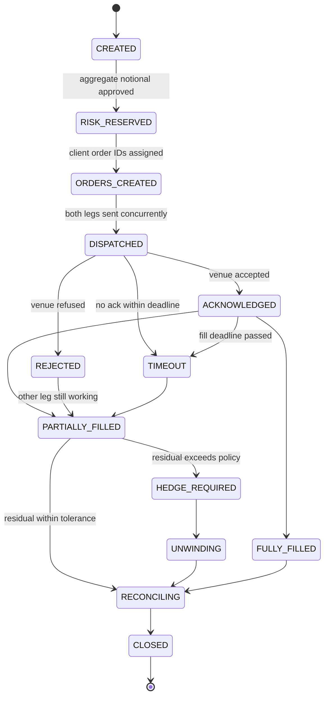
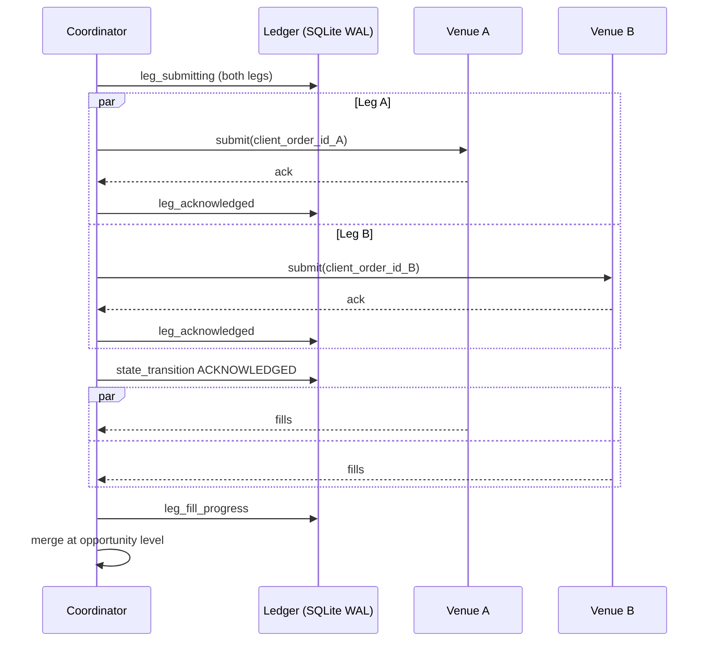
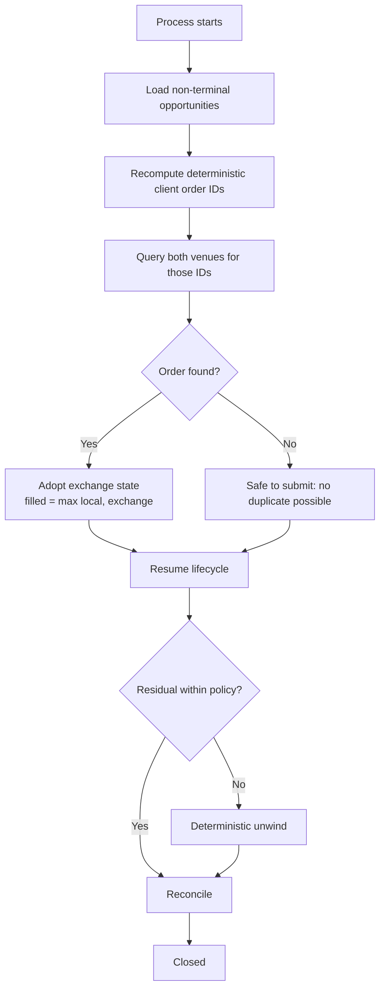

# Two-Venue Concurrent-Leg Execution

How the platform executes a two-leg opportunity across two venues at the
same time while guaranteeing that a crash, a timeout, a reconnect, or a
retry can never produce a duplicate order.

Implemented in `src/trading_platform_poc/opportunity.py` and
`src/trading_platform_poc/opportunity_store.py`. Covered by
`tests/test_opportunity.py` (38 tests) and `tests/test_opportunity_demo.py`
(13 tests).

Run it offline, on any operating system, with no credentials:

```bash
trading-platform-poc opportunity-demo --scenario all
```

## Why this exists

An arbitrage or basis trade is only profitable if both legs land. The
moment one venue fills and the other does not, the desk is holding naked
directional risk it never intended to take. The hard part is not sending
two orders — it is deciding what to do when the second one does not come
back, without ever sending it twice.

## Opportunity lifecycle



Every transition is written to the ledger **before** the action it
authorises is taken. The event log is append-only and monotonically
sequenced, so the exact order of events survives a restart.

| State | Meaning | Exit condition |
| --- | --- | --- |
| `CREATED` | Opportunity detected and persisted | Risk approved |
| `RISK_RESERVED` | Aggregate exposure reserved | Orders generated |
| `ORDERS_CREATED` | Deterministic client order IDs assigned | Dispatch begins |
| `DISPATCHED` | Both legs in flight concurrently | Ack, reject, or timeout |
| `ACKNOWLEDGED` | At least one venue accepted | Awaiting fills |
| `PARTIALLY_FILLED` | Legs disagree on filled quantity | Hedge, complete, or unwind |
| `FULLY_FILLED` | Both legs reached target | Reconcile |
| `REJECTED` | A venue refused an order | Retry or unwind |
| `TIMEOUT` | A deadline elapsed | Cancel, retry, or unwind |
| `HEDGE_REQUIRED` | Residual exceeds policy | Hedge complete |
| `UNWINDING` | Neutralising residual exposure | Flat |
| `RECONCILING` | Validating positions and PnL | Views agree |
| `CLOSED` | Terminal and archived | — |

## Identity and idempotency

Duplicate suppression is not a retry counter — it is arithmetic. Every
identifier is a pure function of the signal, so the same input always
produces the same identifier no matter how many times it is computed.

```
opportunity_id  = "OPP-" + sha256(strategy_id | version | signal_id)[:16]
leg source_id   = f"{opportunity_id}:{leg_index}"
client_order_id = adapter.client_order_id(source_id)   # venue-specific, deterministic
idempotency_key = sha256(opportunity_id | leg_index | venue | symbol | side | quantity)
```

Three consequences fall out of this:

1. **Replaying a signal is free.** `execute()` looks the opportunity up
   first; if it is terminal the stored result is returned and no venue is
   contacted. Because the ID hashes only strategy, version and signal ID,
   the stored `signal_hash` — which covers the legs — is compared before
   anything is reused; a mismatch raises `SignalHashMismatchError` rather
   than executing a plan nobody asked for. Verified by
   `replay_is_idempotent` in the demo output.
2. **A retry cannot duplicate.** The retry recomputes the *same* client
   order ID. Note that the venue is not trusted to enforce this on its
   own: Binance frees a client order ID once the order stops being live,
   so a blind resubmission during recovery would open a *second* real
   order. Any leg that has already been sent is therefore resynced
   against the venue before it is ever resubmitted.
3. **Recovery needs no bookkeeping.** After a crash the platform
   recomputes the client order ID and asks the venue whether it exists.

`legs(venue, client_order_id)` and `fills(venue, trade_id)` both carry
`UNIQUE` constraints in SQLite, so duplicate suppression is enforced by
the database even if application logic is wrong. A leg's identity
columns — venue, symbol, side and target quantity — are immutable once
written; an update that tried to change them raises `LegIdentityError`
instead of silently booking one venue's trade under another's name.

## Concurrent dispatch



Legs are dispatched with `asyncio.gather`, so neither blocks the other.
Each leg carries its own deadline via `asyncio.wait_for`; a slow venue
cannot hold the other leg hostage.

## Timeouts

Deadlines are per leg and measured from dispatch (`OpportunityTimeouts`).

| Stage | Default | On expiry |
| --- | --- | --- |
| Acknowledgement | 100 ms | Query venue, then cancel or abandon |
| First fill | 500 ms | Query venue, cancel outstanding quantity |
| Complete fill | 2000 ms | Cancel remainder, hedge or unwind |

Expiry distinguishes two outcomes, and the difference matters:

- **`ABANDONED`** — no exchange order ID was ever issued *and* a resync
  found nothing on the venue. There is positive evidence no order exists,
  so it is safe to treat as terminal.
- **`TIMED_OUT`** — an order may still be live. It must be cancelled, and
  its residual counts toward exposure.

Never assume a timeout means nothing happened. Ask the venue.

## Reject classification

`classify_reject()` normalises the message (folding `_` and `-` to spaces,
so `PERCENT_PRICE` and `percent price` classify identically) and maps it
to an action. Retrying an invalid order just burns rate limit.

| Reason | Action | Retried |
| --- | --- | --- |
| `PRICE_BAND` | Reprice | Yes |
| `POST_ONLY` | Cancel and replace | Yes |
| `INSUFFICIENT_MARGIN` | Abort opportunity | No |
| `RISK_LIMIT` | Reject permanently | No |
| `EXCHANGE_MAINTENANCE` | Route to alternate venue | No |
| `INVALID_ORDER` | Manual investigation | No |
| `RATE_LIMIT` | Backoff | Yes |
| `UNKNOWN` | Treat as ambiguous, resync | Yes |

Transport failures are classified separately by `classify_retry()`, which
returns `RESEND`, `RESYNC`, `BACKOFF`, or `ABORT`. Anything ambiguous
becomes `RESYNC` — query the venue, never blindly resend.

## Residual exposure and deterministic unwind

`ResidualPolicy` bounds how much unmatched exposure is tolerated and for
how long.

| Metric | Default |
| --- | --- |
| Maximum residual quantity | 5% of target size |
| Maximum residual duration | 2000 ms |
| Maximum hedge delay | 500 ms |

Breaching any bound forces an unwind. Venue selection is a total order,
so identical inputs always produce an identical decision:

```
rank = (priority_index, all_in_cost, venue_name)
all_in_cost = ask * (1 + fee)      for a BUY
            = -(bid * (1 - fee))   for a SELL
```

`priority_index` comes from `unwind_venue_priority`; `venue_name` breaks
exact cost ties alphabetically so the outcome is never arbitrary. The
chosen plan and every rejected candidate are persisted, so an auditor can
reconstruct why a venue was picked.

## Restart recovery



`coordinator.recover()` resumes every non-terminal opportunity. Filled
quantity uses `max(local, exchange)` so a stale poll can never rewind
progress. A late acknowledgement arriving after a timeout is matched by
its original client order ID and folded into the existing leg — it never
creates a second order.

## Four-way reconciliation

An opportunity closes only when four independently derived views agree.

| View | Source |
| --- | --- |
| Exchange positions | Queried back from each venue |
| Local positions | The leg table in the ledger |
| Risk positions | The risk engine's own accumulator |
| Opportunity ledger | Individual fill records |

The risk view is deliberately *not* recomputed from the leg table. It is
accumulated incrementally as fills are observed, so it can genuinely
disagree with the ledger; a view derived from the same rows could never
disagree and the comparison would be theatre. After a restart there is no
in-memory history, so it is re-derived once, explicitly.

Closure additionally requires: net position flat within tolerance, no
open orders, risk reservation released, and PnL, fees, slippage, and
hedge cost finalised. Any disagreement is recorded in `discrepancies` and
the opportunity is flagged rather than silently closed.

### Fees are never summed across currencies

Venues denominate fees differently — Binance charges a spot buy
commission in the base asset, OKX reports fees as a negative number.
Adding those together produces a meaningless figure, so fees are
aggregated per currency into `fees_by_currency`. The scalar `fees` field
carries only the `quote_currency` total, which is the one that can be
subtracted from a quote-denominated PnL. Anything left in another
currency is surfaced as a discrepancy rather than silently converted at
a rate the platform does not have.

## Demo output

`--scenario partial` fills 0.4 on one venue and 1.0 on the other, then
unwinds the 0.6 residual:

```json
{
  "state": "closed",
  "transitions": ["created", "risk_reserved", "orders_created", "dispatched",
                  "acknowledged", "timeout", "partially_filled",
                  "hedge_required", "unwinding", "reconciling", "closed"],
  "unwinds": [{"venue": "okx", "side": "buy", "quantity": "0.6",
               "reason": "residual_exposure"}],
  "reconciliation": {"net_position": "0.0", "balanced": true,
                     "open_order_count": 0, "risk_released": true}
}
```

`--scenario reject` shows a `MIN_NOTIONAL` rejection classified as
`invalid_order` → `manual_investigation`, attempted exactly once, with the
opposing leg's exposure unwound deterministically.

## Portability

`opportunity.py`, `opportunity_store.py`, and `simulated_venue.py` import
nothing beyond the standard library and this package — no native
extensions, no `pyarrow`, no `hftbacktest`. A consumer whose environment
blocks native DLLs (a known Windows Application Control failure mode) can
still run the full state machine, including the demo. `sqlite3` ships
with CPython on every supported platform.
