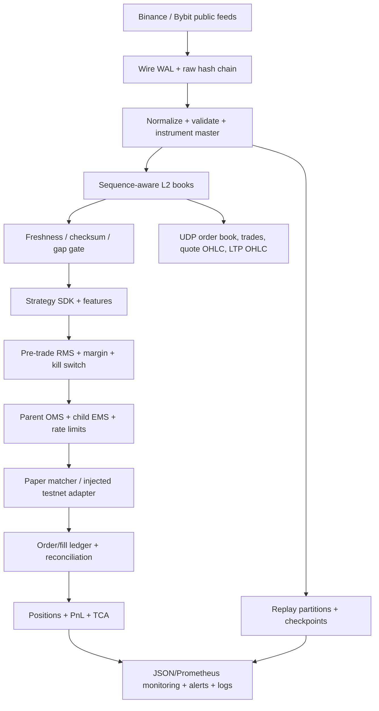

# Local installation and complete runbook

This runbook executes the Phase 1 platform locally. The offline acceptance path
uses no exchange credentials and cannot place live orders. The optional network
path connects only to Binance and Bybit public market-data endpoints.

## Architecture



Safety boundaries:

- `BACKTEST` and offline acceptance reject credential references.
- `PAPER` uses the deterministic local venue matcher.
- `TESTNET` is an interface/acceptance boundary in Phase 1; real authenticated
  Binance/Bybit transports are not bundled.
- `live-orderbook` is public data capture only. It does not submit orders.

## Windows 10/11 PowerShell

Install Python 3.11 or newer, then extract the ZIP and open PowerShell in its
root directory:

```powershell
py -3.11 -m venv .venv
Set-ExecutionPolicy -Scope Process Bypass
.\.venv\Scripts\Activate.ps1
python -m pip install --upgrade pip
python -m pip install -e .
```

Run every finite offline function and all controls:

```powershell
.\scripts\run_all_local.ps1
```

Also test current public endpoints, download the contract master, run both live
books for 30 seconds, publish UDP, build one-minute bars, and refresh monitoring:

```powershell
.\scripts\run_all_local.ps1 --public-network --live-seconds 30
```

## macOS / Linux

```bash
python3 -m venv .venv
source .venv/bin/activate
python -m pip install --upgrade pip
python -m pip install -e .
chmod +x scripts/run_all_local.sh
./scripts/run_all_local.sh
```

Optional bounded public-network checks:

```bash
./scripts/run_all_local.sh --public-network --live-seconds 30
```

Every invocation creates an isolated `runs/local-all-<UTC timestamp>/` folder
and stops immediately on the first failed control. Success ends with
`ALL REQUESTED LOCAL CHECKS PASSED` and writes
`local_acceptance_summary.json`.

## Continuous local services

Terminal 1 — continuously capture/reconstruct public Binance and Bybit books,
public trades, two independent one-minute OHLC streams, pipeline monitoring,
and UDP multicast:

```powershell
crypto-stat-arb live-orderbook --config config/research.json --output-dir data/live
```

Stop safely with `Ctrl+C`. For market data without UDP, add `--no-udp`.

Terminal 2 — consume all multicast messages:

```powershell
python examples/udp_multicast_consumer.py --group 239.255.77.77 --port 19001
```

Terminal 3 — watch health on Windows:

```powershell
Get-Content data\live\<session-id>\pipeline_monitoring.json -Wait
```

On macOS/Linux use:

```bash
tail -f data/live/<session-id>/pipeline_monitoring.json
```

Prometheus-compatible metrics are in the adjacent `pipeline_metrics.prom`.

## Individual commands

Run the full test suite:

```powershell
python -m unittest discover -s tests -v
```

Run one deterministic paper/backtest session:

```powershell
crypto-stat-arb backtest --config config/research.json --events data/samples/two_venue_books.jsonl --output runs/sample
```

Run the advanced SDK historical backtester on Tardis-layout data:

```powershell
crypto-stat-arb sdk-backtest --pair BTCUSDT --data-root data/tardis --start 2026-04-16 --end 2026-04-25 --mode taker_taker --latency-preset singapore --output runs/sdk_backtest/BTCUSDT
```

Run the stable Strategy SDK example:

```powershell
python examples/strategy_sdk.py
```

Download the current public derivatives contract master:

```powershell
crypto-stat-arb contract-master --output-dir data/contract_master
```

Capture, verify, normalize, and checkpoint a raw partition:

```powershell
crypto-stat-arb raw-capture --input data/samples/raw_depth.jsonl --output-dir data/raw --session-id session-001
crypto-stat-arb verify-raw --raw data/raw/session-001/raw.jsonl
crypto-stat-arb normalize --config config/research.json --raw data/raw/session-001/raw.jsonl --output data/canonical/session-001/events.jsonl
crypto-stat-arb pipeline-run --config config/research.json --state-db data/pipeline/state.sqlite --job-id depth-local --partition-id part-001 --raw data/raw/session-001/raw.jsonl --output data/canonical/part-001/events.jsonl
```

Query correlated logs:

```powershell
crypto-stat-arb log-query --db runs/sample/structured_logs.sqlite --level ERROR --limit 100
crypto-stat-arb log-query --db runs/sample/structured_logs.sqlite --opportunity-id <opportunity-id>
```

## Forward test, calibration and benchmark

```bash
# Live public books -> shared session with simulated fills (no orders sent)
PYTHONPATH=src python -m crypto_stat_arb.cli live-paper --config config/research.json \
  --output-dir runs/paper --session-id p1 --max-runtime-seconds 600 --no-udp
# Replay exactly what the paper session saw, then compare and calibrate
PYTHONPATH=src python -m crypto_stat_arb.cli backtest --config config/research.json \
  --events runs/paper/p1/paper/canonical_events.jsonl --output runs/paper_replay
PYTHONPATH=src python -m crypto_stat_arb.cli compare-runs --replay runs/paper_replay \
  --paper runs/paper/p1/paper --output runs/replay_vs_paper.json
PYTHONPATH=src python -m crypto_stat_arb.cli calibrate-latency \
  --run-dir runs/paper/p1/paper --output runs/latency_fit.json
# MR-14 performance baseline and public instrument status
PYTHONPATH=src python -m crypto_stat_arb.cli benchmark --config config/research.json --output runs/bench
PYTHONPATH=src python -m crypto_stat_arb.cli instrument-status --config config/research.json
```

If Python cannot verify exchange TLS certificates on macOS, point
`SSL_CERT_FILE` at an export of the system trust store; never disable
verification. `scripts/run_all_local.py --public-network` runs a bounded
live paper session, its replay, the comparison and a calibration.

## Continuous paper trading with the watcher

```bash
PYTHONPATH=src python scripts/paper_watcher.py --root runs/paper_watch \
  --first-cycle-minutes 5 --cycle-minutes 30
tail -f runs/paper_watch/watcher.log      # ALERT / CYCLE lines
cat runs/paper_watch/report.md            # per-cycle table and latest issues
kill -TERM $(cat runs/paper_watch/watcher.pid)   # if started with nohup and a pid file
```

## Outputs to inspect

| Output | Purpose |
| --- | --- |
| `pipeline_monitoring.json` | Combined pipeline, strategy, execution, account, margin, kill, restart and alert state |
| `pipeline_metrics.prom` | Prometheus-compatible machine metrics |
| `structured_logs.sqlite` / `.jsonl` | Searchable correlated source-to-child logs |
| `ledger.jsonl` / `order_trace.jsonl` | Durable parent, child, route, callback and fill history |
| `account_state.json` | Positions, balances, capacity and PnL |
| `rms_reconciliation_report.json` | Reconcile-before-resume decision |
| `tca_report.json` / `tca_daily/` | Slippage, fees, rejects, residuals and missed opportunities |
| `kill_switch_status.json` | PM-visible kill lifecycle and reset lock |
| `margin_status.json` | Initial/maintenance margin and liquidation buffer |
| `exposure_utilization.json` | Gross/net/venue/instrument limit utilization |
| `local_acceptance_summary.json` | Final local smoke-test result |

## What “all functionality” means in Phase 1

The script exercises all offline components, public-data transformations,
paper OMS/RMS, persistence, monitoring, TCA, alerting, release management,
credential controls, and restart controls. With `--public-network`, it also
checks current public REST/WebSocket connectivity and UDP publication.

Real testnet/live order placement is intentionally not available yet. To enable
it, implement authenticated Binance and Bybit transports behind
`TestnetVenueAdapter`, connect a production secret manager, then complete venue
certification, reconciliation, and kill/recovery drills before any capital is
enabled.
