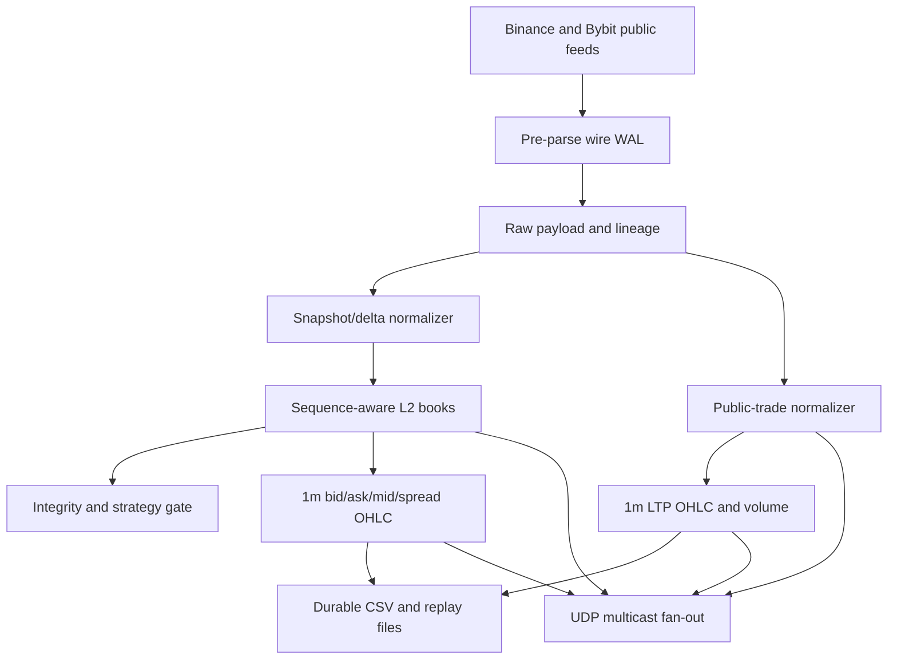
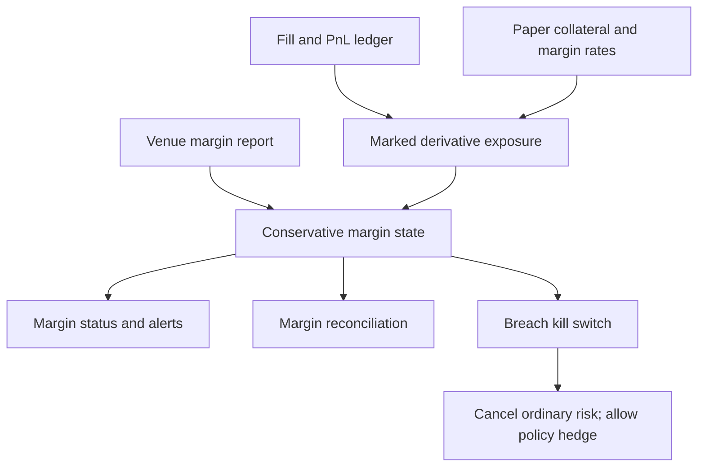

# Phase 1 architecture

This project implements the minimum backtest-ready vertical slice described in the supplied requirements. The supplied research configuration starts with one strategy, one logical portfolio, two venues and spot instruments; the shared risk model also supports derivative and leveraged paper portfolios.

## Event path

1. The live collector connects to Binance and Bybit concurrently. Every received WebSocket/HTTP frame first enters a durable pre-parse wire WAL, then an enriched raw session record with venue/vendor/channel/host metadata, payload checksum, deterministic raw reference and tamper-evident record hash chain.
2. Raw records are mapped to the frozen, versioned `MarketEvent` envelope while native fields remain in `native`; every canonical event retains its `raw_ref`, source/exchange/local timestamps, sequence and quality flags.
3. `CanonicalEventDispatcher` validates once and delivers the same immutable object instance to the strategy path and canonical recorder.
4. Time integrity checks latency, feed age and cross-venue skew. Impossible timestamps are recorded but blocked from book and strategy mutation; replay uses recorded receive time as simulated time.
5. Deltas received before the first snapshot are bounded and buffered. A snapshot drops obsolete updates and replays only the contiguous remainder; Binance `U...u` ranged updates may bridge the next expected sequence.
6. Duplicate and older updates are counted but never applied. A forward gap stops mutation and requires snapshot recovery; supplied venue checksums are validated by the configured adapter algorithm.
7. Each venue book exposes `SYNCING`, `VALID`, `STALE`, `GAP_DETECTED` or `CHECKSUM_FAILED`. Only `VALID` is tradable.
8. The book-integrity gate suspends strategy evaluation when any required venue is unsafe, requests cancel-all once per valid-to-unsafe transition, and resumes only when every book is valid.
9. Replay applies a stable total ordering: receive time, exchange time, source time, venue, sequence range and event ID.
10. The strategy evaluates only valid, fresh books and creates an immutable opportunity with source event IDs.
11. The OMS creates one parent plan and two child orders, validates instruments, reserves package risk and dispatches to a deterministic depth matcher.
12. Fills update the event ledger and venue positions. The parent reports gross PnL, fees, residual and net PnL.
13. A run writes canonical events, book and time-integrity reports, gate status, ledger, summary, input hashes, configuration and deterministic result hash.
14. The ingestion orchestrator commits canonical records and source checkpoints atomically in SQLite, then publishes partition JSONL and state sidecars by atomic file replacement.
15. The quality gate combines book, time and pipeline metrics, emits real-time threshold flags, and publishes a fail-closed approval report plus hash-chained defect log.
16. The alignment stage merges immutable venue streams in recorded-time order; one fingerprinted validity/age policy is enforced before both opportunity creation and OMS routing.
17. Live partitions rotate by time or byte size. Connection loss, stale data, gaps, crossed books and checksum failures force venue-specific reconnect/resynchronization with bounded exponential backoff; graceful shutdown closes checksummed part and session manifests.
18. Every valid reconstructed top-of-book update feeds a receive-time one-minute quote resampler. Independent public trade streams feed a second receive-time resampler whose open/high/low/close are actual LTP values. Completed per-venue bars are appended to separate CSV files, while books, trades and both bar types are published through non-blocking UDP multicast for multiple consumers.
19. Book validity is projected into venue execution mode. `VALID` and within-age is `ACTIVE`; every other state is `RISK_REDUCING_ONLY`. The transition cancels ordinary venue orders, retains hedge/unwind work, rejects routing against a non-tradable book and restores ordinary routing only after a fresh valid snapshot.
19. The OMS converts each child into the versioned common submit/cancel/replace request and sends that immutable request through the strategy-selected venue adapter. Ordered callbacks update child state and are persisted in a correlation-complete, idempotent execution trace.
20. Strategy routing instructions define eligible venues, priority and maker/taker intent. Account/venue state, rate-limit headroom, order support, instrument availability and book availability are validated before capacity is reserved and the chosen adapter is called; an explicit override can change venue but not bypass safety checks.
21. Paper OMS state is optionally committed to SQLite WAL as atomic parent snapshots plus append-only lifecycle events. Dispatch intent is durable before venue contact; restart restores nonterminal plans without resubmission and reconciles deterministic child IDs to authoritative venue order snapshots before resuming.
22. Package admission computes position, cash, initial margin, planned residual and venue message requirements for every intended child before mutating capacity. All buckets are reserved together or none are; only a successful reservation permits the first dispatch, and paper account snapshots use the identical rule.
23. Accepted children follow `DETERMINISTIC_SEQUENTIAL` parent-list order. Each adapter call has independent start/end/duration measurements, each callback has adapter and local observation timestamps, and every parent state change is appended to the timestamped ledger; an injected paper clock replaces the deterministic replay clock without changing interfaces.
24. A validated OMS state machine makes `CLOSED` the sole immutable parent terminal state. Adapter callbacks, private-stream events, REST snapshots and timer events use one canonical update reducer with restart-safe duplicate suppression, non-regressing cumulative fills, deterministic terminal-conflict precedence and a separately persisted business outcome.
25. Per-venue EMS throttles model fixed-window usage with explicit reject, bounded FIFO queue or deterministic delay actions. Current usage/headroom and release times are recorded at each bind. Throttled OMS parents remain open with package risk reserved until due children are released and reconciled through the same callback state machine.
26. A residual policy bounds exposure by size and age, chooses hedge venues in configured order and maps passive/normal/aggressive urgency to deterministic price and order semantics. Failed packages emit reduce-only unwind children; risk-reducing orders may continue under a strategy stop only when policy explicitly allows it. A parent cannot reconcile or close while residual exposure exceeds the approved bound.
27. The OMS writes one correlated lifecycle ledger for submit, acknowledgement, partial/full fill, cancel, reject, timeout and synthetic controls. A shared cumulative-fill accountant makes callback, private-stream and REST replay idempotent. Before closure, the RMS audits order/fill lineage; testnet reconciliation additionally compares venue orders, positions, session balance deltas and controls, activating the kill switch on any unexplained difference.
28. For derivative or leveraged accounts, the RMS marks initial/maintenance margin and the liquidation buffer from ledger positions and collateral. It monitors the lower of local and venue-reported margin, warns before the configured buffer, fails closed below maintenance and reconciles all margin-state fields. Cash spot accounts remain explicitly `NOT_APPLICABLE`.
29. One monitoring envelope composes job state, freshness, partition completion, book integrity, schema/instrument versions, replay throughput, reconnects and persistence lag. Replay and orchestration write final metrics; live services atomically refresh JSON and Prometheus output on a timer with configurable critical/degraded thresholds.
30. The same envelope correlates strategy opportunities and expected edge to route decisions, order states/outcomes, residuals, per-child latency and PnL. It also projects rate-limit headroom, EMS connector admission health, ledger-derived positions/balances, margin and kill-switch state into JSON and Prometheus gauges; an end-to-end two-venue paper-simulation test covers opportunity through reconciliation.
31. Basic TCA deterministically aggregates child outcomes by venue, instrument and order type, measures signed decision-price slippage and fees, classifies residual/unwind and missed packages, and preserves canonical hashes plus source-event/raw references. Every run writes a complete report and UTC daily paper reports, while the shared pipeline envelope and Prometheus output expose their headline statistics.
32. A central structured-log envelope joins canonical source/raw references, feature state, opportunity, risk decision/reservation, parent plan, child order, request, route and callback. Paper-host and live connector records share durable JSONL and indexed SQLite views; the query CLI filters every correlation layer, and failed opportunities are automatically expanded into replayable traces.
33. Monitoring classifies threshold and control incidents through one alert-ownership matrix. Failed ingestion, invalid books, replay failures and risk breaches carry named owners, severity and response expectations; all remaining paper alerts use owned pipeline/execution fallbacks, and forced alerts exercise the same JSON/Prometheus path.
34. Strategy SDK v1 hosts the same `on_event` logic over canonical data/replay, features, portfolio, RMS and OMS/EMS facades. Only the venue adapter changes between deterministic paper and explicit testnet transport; testnet mode fails closed unless every configured venue has an adapter.
35. Paper releases snapshot six mandatory version classes—strategy, features, model, parameters, data manifest and simulator config—under a content-addressed ID. Approval and deployment ownership are explicit, deployment history is hash chained, the active pointer is atomic, and rollback/reproduction first reverify stored bytes.
36. Offline backtests reject credential references and plaintext secret fields. Paper/testnet connector access passes through a production secret-manager interface with venue/environment/scope checks, permanent withdrawal denial, per-call mutable-buffer injection/zeroization, versioned rotation/revocation and hash-chained secret-free access audit.

## Live order-book, trade and bar topology

## Correlation model

`source event -> opportunity -> parent plan -> child order -> fill -> position/PnL`

IDs are deterministic UUIDv5 values, so replaying the same inputs cannot create a new logical order.

## OMS/RMS margin control path

## Release boundary

Implemented now: MR-02, MR-03 core trading rules, MR-05, MR-06 freshness/no-lookahead mechanics, MR-07, MR-08 normal/idempotent state path, MR-09 taker fees and depth fills, MR-10 package limits/kill flag, MR-11 internal ledger, and MR-13 run reproducibility.

Next adapters: connect live reconstructed books to the paper loop, add live-session quality approval and metrics/alerts, then add private testnet connectors and automated TCA.
