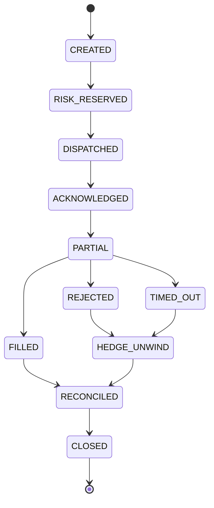
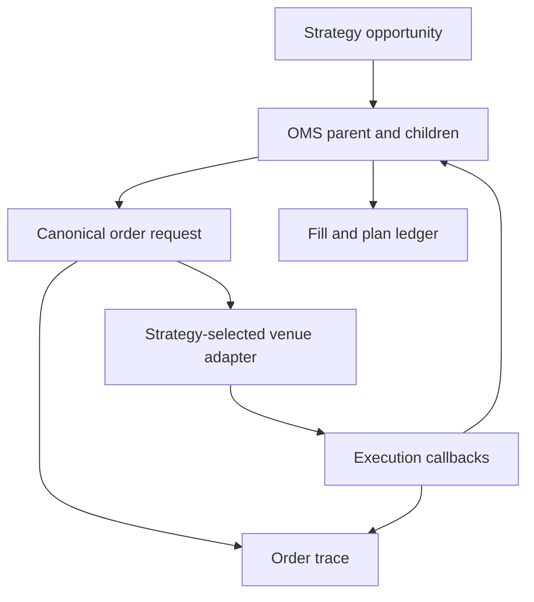

# Common OMS/EMS order API

The strategy-directed router is the single execution boundary for backtesting and paper trading. A strategy selects the venue and constructs one immutable `CanonicalOrderRequest`; the router validates instrument rules and dispatches that same object to the configured venue adapter. Adapters return immutable `ExecutionCallback` objects through the same callback interface.

## Request contract

Every `SUBMIT`, `CANCEL` and `REPLACE` request carries:

- schema version, deterministic request ID and idempotency key;
- child order ID, target order ID where applicable, parent order ID and parent opportunity ID;
- canonical instrument ID and explicit venue;
- side, decimal price and quantity;
- `LIMIT` or `MARKET` order type;
- `GTC`, `IOC` or `FOK` time-in-force;
- post-only and reduce-only flags;
- local request timestamp.

The JSON Schema is `docs/schemas/order_api.schema.json`. A correlated request/callback example is `data/samples/orders/common_order_api_trace.jsonl`.

## Adapter and callback contract

`VenueExecutionAdapter.handle(request, book)` is deliberately small so a deterministic backtest adapter, a paper venue simulator and a future authenticated exchange adapter can be substituted without changing strategy or OMS code. Callback types are `ACKNOWLEDGED`, `PARTIAL`, `FILLED`, `REJECTED`, `TIMED_OUT`, `CANCELLED` and `REPLACED`; every callback repeats request, child, parent, opportunity, venue and instrument correlation IDs.

The included deterministic adapter enforces market/limit, GTC/IOC/FOK and post-only semantics against the reconstructed L2 book. It retains GTC remainders for later cancellation or replacement. FOK rejects unless the full quantity is available. IOC reports the executed quantity and cancels any remainder. Reduce-only is preserved across the boundary for an adapter with account-position state.

## Routing control

`RoutingInstruction` is owned by the strategy and supplies eligible venues, instrument, side, order type, price/size, ordered route priority, maker/taker intent and an optional route override. The router evaluates candidates in priority order unless an explicit eligible override is supplied.

Before dispatch, every candidate receives a recorded `RouteCheck` covering:

- account enabled/disabled state;
- venue enabled/disabled state;
- current message-capacity usage and rate-limit headroom;
- instrument availability at that venue;
- market/limit order support;
- post-only maker and reduce-only support;
- availability of the venue's reconstructed book.

An unsafe override is rejected rather than bypassing these controls. With no override, an unavailable preferred venue is skipped and the next eligible priority is considered. One unit of rate-limit capacity is reserved only after request validation and immediately before adapter dispatch. Repeated idempotency keys reuse cached callbacks without consuming capacity again.

### Rate-limit and throttle semantics

`VenueRouteStatus` models a deterministic fixed window with capacity, used messages, window start/duration, bind policy, optional delay and maximum queue depth. The bind policies are explicit:

- `REJECT`: record the exhausted usage/headroom and reject that candidate; normal route priority may select the next safe venue.
- `QUEUE`: retain the exact immutable request and release it FIFO at the next window boundary.
- `DELAY`: retain the request until the next window boundary plus the configured deterministic delay.

Account/venue disablement, unsupported order semantics, missing instruments/books, zero capacity and queue overflow always reject; they cannot be bypassed by queue or delay policy. A pending idempotency key returns the same queued request and never creates a second queue entry. Capacity is incremented only at actual adapter dispatch.

`process_throttled(now_ns)` releases due EMS requests in `(release time, queue ordinal, route ID)` order. When a burst exceeds the new window capacity, the remaining request receives an exact next-window release time. `OMS.process_throttled_routes(now_ns)` sends the released callbacks through the common state reducer, updates fills/PnL, releases package risk, and closes the parent only after no throttled child remains.

Every `RouteCheck`, `ROUTE_DECISION`, `RATE_LIMIT_ACTION`, `THROTTLE_BOUND`, `THROTTLE_RESCHEDULED` and `THROTTLE_RELEASED` record includes the applicable action and timing. `rate_limit_snapshot()` publishes per-venue policy, capacity, used, headroom, window boundaries, queue depth and next release time. The machine-readable schema is `docs/schemas/rate_limit_status.schema.json`; the bounded burst trace is `data/samples/orders/rate_limit_burst_ledger.jsonl`.

The published routing schema is `docs/schemas/routing_instruction.schema.json`; `data/samples/orders/two_venue_route_override.json` demonstrates a strategy overriding Binance priority and routing to Bybit.

## End-to-end trace

Each unique request produces one `ORDER_REQUEST` trace row followed by its ordered `EXECUTION_CALLBACK` rows. Repeated idempotency keys do not reach the adapter again and create a `DUPLICATE_SUPPRESSED` trace row. Backtests write `order_trace.jsonl`; its IDs join to `OPPORTUNITY`, parent plan, child order and fill records in `ledger.jsonl`.

## Persistent parent plans and restart reconciliation

`ParentPlanStore` is an optional SQLite WAL store for paper execution. One opportunity is uniquely mapped to one parent plan, which contains one or more deterministic child orders. Every parent snapshot and its append-only plan event are committed atomically with full synchronous durability.

The persisted lifecycle includes `PLAN_CREATED`, risk reservation, `DISPATCH_INTENT`, child reconciliation, partial/fill states, hedge/unwind, venue reconciliation and close. Crucially, `DISPATCH_INTENT` is committed before calling the venue adapter. If the process or connector fails after that point, a new OMS instance restores the nonterminal plan and the same child IDs. Calling `execute()` for the same opportunity returns that recovered plan and does not submit again.

Before paper execution resumes, `reconcile_plan()` consumes authoritative REST `VenueOrderSnapshot` records. Private-stream records enter through `ingest_private_stream_update()`. Both routes verify parent, child, venue and instrument identity and then call the same reducer used by synchronous adapter callbacks. Residual exposure, gross/net PnL and fees are recomputed, and the plan closes only when all children have unambiguous terminal states. Missing or nonterminal venue orders leave the plan open with `RECONCILIATION_PENDING`.

The snapshot schema is `docs/schemas/parent_plan.schema.json`. The recovery sequence is illustrated in `data/samples/orders/parent_plan_restart.json`.

## Atomic package risk reservation

Before the parent can enter `RISK_RESERVED` or `DISPATCHED`, `RiskEngine.reserve()` evaluates the complete intended package. It calculates gross and per-order notional, buy-side cash, venue initial margin, simulated per-venue position deltas, planned package residual and the number of outbound submit messages per venue.

`AccountRiskSnapshot` provides the same admission inputs for simulation and paper accounts: account status, available cash, available margin, current base position, maximum absolute position, message capacity/current usage and initial-margin rate. Global simulation limits remain available through `RiskLimits` when no paper snapshot is supplied.

All requirements are computed and checked against temporary totals first. Only after every leg and venue passes are all reservation buckets mutated together. Any cash, margin, position, residual, account or message-capacity failure rejects the parent with `dispatched_children=0`; no adapter receives a child. Reservation creation and release are written to the ledger and persistent parent-plan event log.

The reservation schema is `docs/schemas/risk_reservation.schema.json`. The all-or-none failure example is `data/samples/orders/atomic_risk_rejection.json`.

## Coordinated child dispatch

Phase 1 uses the documented `DETERMINISTIC_SEQUENTIAL` policy. The complete package is admitted and durably enters `DISPATCHED` first; children are then sent in immutable parent-list order (`leg_index=0, 1, ...`). For the current two-venue strategy this means the buy child followed by the sell child. This policy is identical in backtest and paper mode, reproducible, and deliberately explicit rather than relying on scheduler timing.

Every leg records `CHILD_DISPATCH_STARTED` before its adapter call and `CHILD_DISPATCH_COMPLETED` after all synchronous callbacks return. Each acknowledgement, partial fill, fill, rejection, cancel or replacement receives its own `CHILD_CALLBACK_OBSERVED` row with both adapter event time and local observation time. `ChildDispatchMeasurement` reports dispatch start/end/duration, callback count, and first/last callback-observation timestamps independently for each child.

Backtests use a deterministic logical nanosecond clock so replay remains identical. Paper mode may inject the host receive clock through `execution_clock_ns`; monotonic fencing guarantees strictly increasing local observations even if the host clock repeats or moves backward. Parent lifecycle changes are separately written as `PLAN_STATE_TRANSITION` with previous state, new state, reason, parent ID and timestamp.

A representative timestamped ledger is published at `data/samples/orders/coordinated_dispatch_ledger.jsonl`.

## Deterministic execution state machine

`CanonicalOrderUpdate` is the source-neutral boundary for `ADAPTER_CALLBACK`, `PRIVATE_STREAM`, `REST_QUERY`, `TIMER` and `INTERNAL` updates. Each record has a unique update ID, parent/child/venue/instrument correlation, exchange event time, local observation time, optional source sequence, cumulative fill, average price, fee, reason and venue order ID. The contract is published at `docs/schemas/order_state_update.schema.json`.

Each accepted update is appended to the SQLite-WAL plan history in the same transaction as the resulting parent/child snapshot. Update IDs suppress duplicates across restart. Reduction is arrival-order independent: terminal state precedence is `FILLED > CANCELLED > REJECTED > TIMED_OUT`, the greatest cumulative fill wins fill economics, and event time, source sequence, source authority and update ID provide deterministic tie-breakers. A conflict is retained as `ORDER_TERMINAL_CONFLICT_RESOLVED`; it is never silently discarded.



Risk or route admission failures take the exposure-free branch `CREATED → REJECTED → RECONCILED → CLOSED`. `CLOSED` is the only parent terminal state and is immutable; `terminal_outcome` retains the business result. New contradictory updates after closure are rejected and ledgered rather than reopening history. The representative restart/private-stream/timeout/REST convergence trace is `data/samples/orders/converged_state_machine_ledger.jsonl`.

## Residual and unwind control

`ResidualPolicy` makes the failure path executable rather than descriptive. It configures maximum one-sided marked notional, residual base size and age, ordered hedge venues, `PASSIVE`, `NORMAL` or `AGGRESSIVE` urgency, normal-mode price slippage, whether reduce-only orders may continue under a strategy stop, and a bounded attempt count. Passive mode uses post-only GTC at the non-crossing top of book; normal mode uses IOC with a tick-rounded slippage bound; an expired residual or aggressive policy uses market IOC.

After primary children reach terminal states, the OMS recomputes signed exposure from all fills. Exposure above the approved size enters `HEDGE_UNWIND` and creates persistent `UNWIND` children with `reduce_only=true`. Venues are attempted in configured order and every intent, callback, fill, skip, throttle, stop override and limit breach is appended to the same ledger and SQLite plan history. `enforce_residual_limits()` retries open residual plans and escalates urgency at the time deadline.

New strategy admission remains blocked by the risk kill switch. An unwind can pass that stop only when `allow_risk_reducing_under_stop=true`; this exception never changes `reduce_only`. A package closes only at zero exposure or within `max_residual_base`. If books, order support, rate limits or attempts cannot produce that result, the parent remains in `HEDGE_UNWIND`, the package reservation stays active and `RESIDUAL_LIMIT_BREACH` is emitted.

The configuration contract is `docs/schemas/residual_policy.schema.json`; `data/samples/orders/residual_unwind_ledger.jsonl` demonstrates a failed second leg followed by a reduce-only flattening order.

During coordinated dispatch, the OMS measures signed residual and one-sided marked notional after each child callback. A bound emits `LEGGING_LIMIT_BOUND` with the exact limit codes and either `DISPATCH_REMAINING_HEDGE` or `HEDGE_UNWIND`. A child that reduces an already-open package leg is marked `risk_reducing` at the router layer without incorrectly setting the exchange `reduce_only` flag. Configured global, venue and emergency rate-limit stops can therefore be overridden only for that risk-reducing hedge, and every exception is recorded as `LEGGING_CONTROL_OVERRIDE`. See `docs/legging_controls.md`.

## Order/fill ledger and RMS reconciliation

The OMS records each submit/cancel request and every acknowledgement, partial/full fill, rejection, cancellation and timeout in `ORDER_LIFECYCLE`. All records carry deterministic ledger IDs plus parent, opportunity, child, venue and instrument identifiers; requests also retain request and idempotency IDs. Duplicate and terminal-conflict decisions remain visible synthetic control events.

`Ledger.apply_fill()` accounts only the increase in cumulative fill quantity, so duplicate WebSocket callbacks or overlapping REST/private-stream reports cannot double-count a position. It tracks fill-derived session cash deltas and persists later fee or average-price corrections separately.

`OMS.reconcile_risk_state()` compares the canonical ledger to complete venue testnet order results and REST/private account snapshots. It detects orphan/missing orders, duplicate or unexplained fills, state/fill differences, position and balance-delta differences, and account/venue/strategy control inconsistencies. Any issue rejects the report and activates the RMS kill switch. An internal order/fill audit is mandatory before a parent can close.

See `docs/rms_reconciliation.md`, `docs/schemas/order_fill_ledger.schema.json`, `docs/schemas/rms_reconciliation_report.schema.json` and `data/samples/orders/rms_reconciliation_report.json`.



## Python example

```python
request = CanonicalOrderRequest.create(
    action=OrderAction.SUBMIT,
    order_id="child-buy-1",
    parent_order_id="parent-1",
    parent_opportunity_id="opportunity-1",
    instrument_id="BTC-USDT-SPOT",
    venue="BINANCE",
    side=Side.BUY,
    price=Decimal("60000.00"),
    quantity=Decimal("0.010"),
    order_type=OrderType.LIMIT,
    time_in_force=TimeInForce.IOC,
    post_only=False,
    reduce_only=False,
    created_ts_ns=clock_ns,
)
callbacks = oms.route_order(request, binance_book)
```
