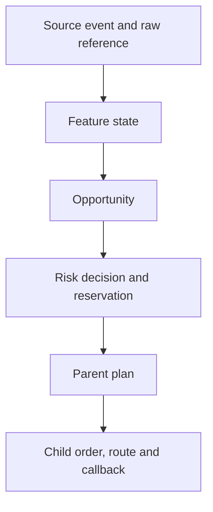

# Structured logs and correlation tracing

The platform writes one central operational log in two synchronized forms:

- `structured_logs.jsonl` for streaming, archival and command-line inspection;
- `structured_logs.sqlite` for indexed searches by correlation field, component, severity, event type and venue.

Paper/backtest runs populate the store from canonical source events, strategy feature state, detected opportunities, pre-trade and reservation decisions, parent transitions, child orders, EMS routes, adapter callbacks, fills and reconciliation. The live market-data service uses the same envelope for connector attempts, connections, reconnects, resynchronization, parse failures and book-state transitions. High-rate raw payloads remain in the authoritative wire/raw/canonical files; log records reference them by `source_event_id` and `raw_ref` instead of duplicating them.

## Correlation chain



Every applicable record carries the stable IDs needed to traverse this chain. Pre-trade-rejected packages still emit both intended `CHILD_ORDER_CREATED` records, so zero-dispatch failures remain fully explainable.

## Search

Query a complete opportunity trace:

```bash
PYTHONPATH=src python -m crypto_stat_arb.cli log-query \
  --db runs/sample/structured_logs.sqlite \
  --opportunity-id <opportunity-id>
```

Other exact filters include `--source-event-id`, `--feature-state-id`, `--risk-decision-id`, `--parent-plan-id`, `--child-order-id`, `--request-id`, `--correlation-id`, `--component`, `--level`, `--event-type` and `--venue`. `--text` searches message and JSON payload content. Results are ordered by timestamp and causal insertion order.

Each run also writes `failed_opportunity_traces.jsonl`. Every row contains a failed opportunity’s complete expanded trace, including referenced source-event records, feature state, risk decision, parent state and intended/dispatched children.

The record contract is `docs/schemas/structured_log.schema.json`, the failed-trace contract is `docs/schemas/failed_opportunity_trace.schema.json`, and a controlled pre-trade rejection is published at `data/samples/logs/failed_opportunity_trace.json`.
